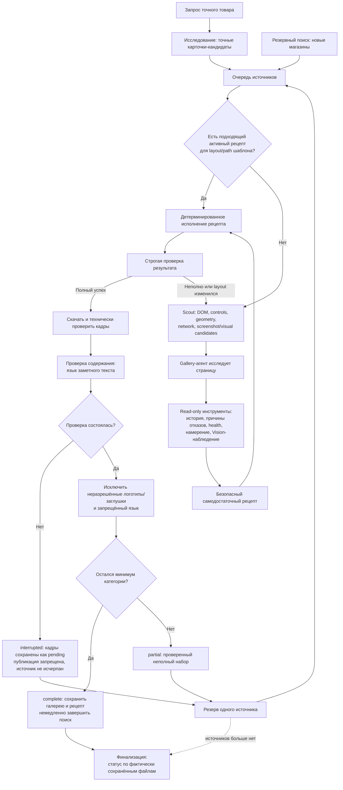
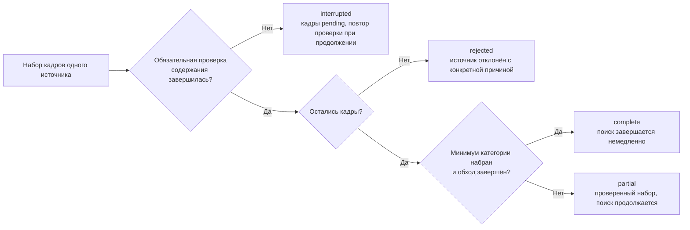
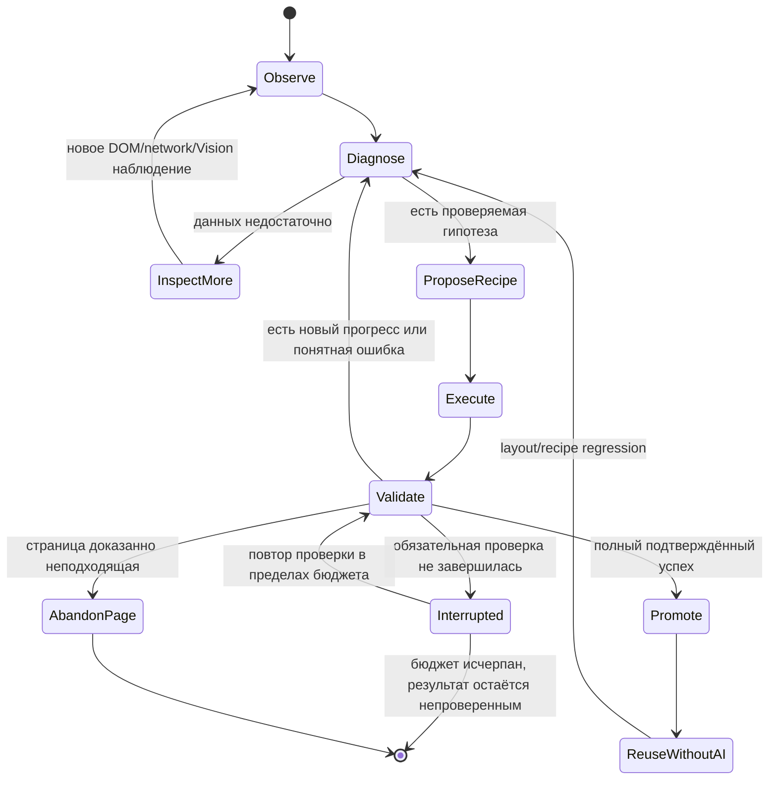

# Стратегия проекта Ningredy

Этот файл — единый источник истины для продуктовой стратегии и обязательных правил проекта. Перед изменением поиска товаров, изображений, AI-рецептов или Telegram-интерфейса необходимо сверяться с ним.

## Главная цель

### Апгрейд поиска 2026-10-19: базы по коду, наблюдатель поиска, сильная модель в крайнем случае

Цель апгрейда (оператор): результат лучше, в будущем дешевле, поиск не отваливается, найденное сохраняется ремонтом, проблемы устраняются.

- **Структурированные базы по коду — подсказки, не проверка.** Open Icecat (бесплатный аккаунт оператора, `ICECAT_USERNAME`) и UPCitemdb (trial, до ~90 запросов в сутки) ищут товар по EAN/UPC или бренду + артикулу. До исследования найденная запись попадает агенту исследования как подсказка вместе со статистикой успехов и провалов каждой базы. Агент сам решает, использовать её или нет, и записывает решение (`code_lookup_verdict`: used / ignored / not_applicable + причина). Каждый запрос к базе записывается в журнал: найдено, нет в базе, бренд закрыт (Full Icecat), квота, ошибка. Любой сбой базы — обычный поиск продолжается без неё.
- **Официальная галерея первой.** Если артикул или GTIN записи Icecat совпадает с найденным агентом товаром и у неё есть кадры шириной от 700 px, её страница ставится первой в очередь источников фото. Галерея такой записи — подтверждённая галерея точного товара, как полностью прочитанный слайдер его страницы (решение оператора 2026-10-25, после #99: официальные кадры отклонялись по одному; в 9 из 35 тестов из записи бралось не больше 12 кадров, и 49 официальных фото не скачивались). Она берётся целиком, без обрезки по числу кадров. Vision не переоценивает модель, цвет и ракурс, а проверяет только то же, что в подтверждённом слайдере: товар — главный предмет кадра, и заметный текст. Ограничение пропорций к ней не применяется; единые минимальные размеры, декодирование и удаление дублей остаются. Совпадение записи по коду — её идентичность: сборка карточки не отбрасывает эти кадры из-за того, что страница Icecat при повторном открытии показала проверку на бота. Сделано 2026-10-25: происхождение идентичности хранится на источнике (`SourceIdentityProvenance`), взгляд на страницу дополняет доказательство записи, не заменяет его и не меняет адрес источника; применимость такого источника решается без агента. Характеристики Icecat сохраняются как текстовое доказательство источника. При показе данных Icecat нужна атрибуция «Specs Icecat»; данные Icecat нельзя использовать для обучения моделей.
- **Инструмент `LookupProductCode`** есть у агента сборки карточки и у управляющего агента восстановления (действие `lookup_code`). Это необязательный инструмент: агент вызывает его, только если считает полезным.
- **Сильная модель — только крайний случай.** Сборка карточки больше не переключается на резервную (более дорогую) модель автоматически. Её разрешает один раз управляющий агент восстановления действием `stronger_model`: когда все доказательства собраны, а обычная модель не может составить из них карточку. С 2026-10-20 это возможно только при включённой в настройках AI галочке «Разрешить сильную (запасную) модель»; по решению оператора она выключена — основная модель должна справляться (за 30 дней сильная модель съела 27% расходов).
- **Наблюдатель поиска.** Пока идёт поиск фото, лёгкий агент читает всю его историю: каждый шаг по порядку с минутой и сайтом (кадры раунда помечены коротким ярлыком: одинаковый ярлык на двух раундах или двух страницах — одни и те же картинки), что повторяется (сколько раз, на скольких страницах, за какие минуты, сколько фото этот сайт принял), итоги по страницам, свои прошлые решения и выполнились ли они, незавершённые шаги, потраченное время и деньги (правило оператора 2026-10-23, после #58: на второй странице de.msi.com наблюдатель видел «те же кадры всего два раунда», хотя те же пять кадров шли уже одиннадцатый раунд). Он смотрит, когда поиск сделал что-то новое, — примерно раз в минуту, — и раз в 3 минуты, пока поиск молчит, но никогда дважды на одну и ту же картину. Он решает: продолжать; уйти с текущей страницы к следующему источнику; бросить сайт целиком (`skip_site`: сайт отказывает или его страницы дают те же кадры или ничего — больше его страниц в этом поиске не открывать); закончить поиск фото и собрать карточку из найденного. Это решение агента, такое же, как отказ тренера от страницы, а не серверный лимит раундов (правило о раундах обучения в разделе «Настраиваемые лимиты» не меняется). Решения попадают в один «ящик», который читает каждый цикл поиска: раунд обучения, переход к следующему источнику, очередь источников, страницы резервного поиска. «Уйти со страницы», сказанное снаружи, относится только к той странице, о которой сказано. Найденные фото и факты сохраняются. Решение и причина пишутся в журнал (`search_supervision`) и в Telegram. Если наблюдатель не ответил или ответил неправильно, поиск идёт дальше как обычно. Новый поиск или продолжение оператора начинаются без прежнего решения «закончить»; брошенные сайты остаются брошенными для этого запроса. Уточнение 2026-10-25 (после #161: десять «продолжаем» подряд, пока пять магазинов отдавали миниатюры и 403, и поиск дошёл до 28-й минуты ради одного фото; #168, #173: «закончить» сказано снаружи, когда карточка уже собиралась): наблюдатель судит как человек, который платит за каждую минуту — «продолжать» только с названным следующим шагом и причиной, почему он даст принятые фото; «время и деньги ещё есть» — не причина продолжать, прошедшее время само по себе — не причина останавливаться. Сайт с отказом или только с миниатюрами бросается сразу; страница после второго раунда без новых кадров покидается; при достигнутом минимуме фото категории и двух источниках без прибавки — закончить и собрать карточку. Наблюдатель видит фазу запроса (поиск фото / сборка карточки), минимум фото категории, минуты с последнего принятого фото и причины отказа загрузок по каждому сайту; во время сборки карточки его решения о поиске фото не исполняются. Решение «закончить поиск фото» действует на весь запрос, включая автоматические продолжения; снимает его только продолжение оператора — новый запрос с новым номером (2026-10-25, после #178: после команды наблюдателя автопродолжение запустило четыре новых цикла по 15 секунд, каждый забывал команду).

- **Сейвер перед ответом об ошибке.** Если запрос окончательно упал после того, как черновик уже сохранён, оператор получает не голую ошибку, а сохранённое. При временном сбое (таймаут, сеть, лимит частоты, неизвестная ошибка) и остатке денег поиск один раз сам продолжается с места остановки в том же бюджете. При повторном сбое, исчерпанном бюджете или ошибке настройки (квота, ключ, модель) оператор получает сохранённый черновик с обычными кнопками и объяснение. Сейвер работает без AI-вызова, потому что сбой может быть у самого AI-провайдера. Решения пишутся в журнал (`delivery_guard`). То же воскрешение — когда обработчик остановился посреди поиска (перезапуск бота, сбой процесса): повторная доставка запроса с уже сохранённым черновиком продолжает его с места остановки (фото, пройденные страницы и решения наблюдателя сохраняются, бюджет общий) или доставляет готовую карточку, а не начинает исследование заново с дублем черновика (правило оператора 2026-10-23). Воскрешение одно на черновик: если поиск остановился снова, оператор получает найденное.
- **Технический сбой проверки — не вердикт.** Проверка пригодности фото при сбое один раз повторяется сразу. Если и повтор не удался, вердикт помечается как технический сбой, и выбранная галерея перепроверяется перед сборкой карточки, а не считается неподтверждённой. Иначе один таймаут заставлял бросать хороший источник (живой #443). Таймаут этой проверки поднят с 20 до 40 с: медиана 11 с, p90 16 с, самый долгий успешный вызов шёл 20 с.
- **Голый штрихкод или артикул — запрос найти товар.** Главный агент не спрашивает «искать ли в интернете» (живой #442).
- Записи журнала со страниц с битой UTF-8 больше не теряются: битые символы заменяются.

### Планы (не реализовано, записано 2026-10-19)

- **Gemini как выбираемый провайдер.** Сейчас все вызовы идут через OpenAI (`AiSettings::providerFor`). Исследование товара собирает доказательства из потоковых событий OpenAI `web_search` (`ActivityAwareOpenAiGateway`). Для Gemini нужны: ключ `GEMINI_API_KEY` оператора, провайдер в `config/ai.php`, модели с ценами в каталоге, выбор провайдера по модели и отдельный сбор доказательств из grounding-метаданных Gemini. Сначала — сравнительный прогон на 20 эталонных товарах, потом решение.
- **Full Icecat** (от ~€375/мес) открывает AMD, Intel, WD и других. Не сейчас: сначала посмотреть статистику `not_found`/`restricted` по журналу баз.
- **Рейтинг доменов по принятым фото:** поднимать в очереди сайты, чьи кадры чаще проходят Vision, и опускать те, что чаще проваливаются.
- **Дешёвый поиск ссылок** (например, Serper) для резервного discovery вместо платного web search, где хватает списка URL.
- **Кэш галерей по корпусу и цвету:** не искать заново фото для другой комплектации того же корпуса.
- **Еженедельный эталонный прогон** 20 товаров через Batch API (дешевле) — регрессия качества и стоимости.
- **Разбор корзины «прочее»** в анализе расходов (~29% трат без явной стадии).
- **schema.org Product:** чаще брать картинки из разметки страницы до запуска Playwright.
- **Рефакторинг админки (внешний вид):** аккуратнее страницы, таблицы и формы Filament, единый стиль.
- **Заметки по инструментам с ручной правкой.** Сейчас каждый шаг баз пишется в журнал (`code_lookup`), а статистика агента (включая бренды, закрытые в бесплатном Icecat) собирается из журнала за 30 дней. Отдельная таблица с миграцией нужна, только если оператор захочет сам править такие заметки в админке, как заметки доменов.

### План после приёмочного прогона 2026-10-21 (30 запросов, не реализовано)

Итог прогона: 23 чистых карточки, медиана 4,5 мин и $0,07, всего $3,21. Не дотянули до порога: #598 и #611 дольше 30 минут (до правки стража на 28-й минуте), #609 — цвет ослаблен (серебристый принят как Steel Grey), #621 — 0 фото (наблюдатель остановил на 10-й минуте, карточка не собрана), #629 — нет страницы магазина, только Icecat, #588 — падение на пустом ответе (исправлено).
1. Полная картина для наблюдателя и выбор очереди: в данные агента — домены с рабочими рецептами, заблокированные домены и рецепты (`disabled`), сайты, которые нам отказывают, и оставшаяся очередь источников этого поиска; на шаге «следующий источник» агент сам называет, какой магазин открыть (цикл источников в `ProductImageStorage` перевести с `foreach` на управляемую очередь).
2. Сейвер решает через наблюдателя (вид `search_failed`): продолжить или показать сохранённое; без агента — только при падении самого провайдера. В тестах агент обязательно подменяется (`SearchProgressAgent::fake`), иначе тест пойдёт в настоящий API.
3. Заметка оператору изнутри поиска: `operator_note` наблюдателя внутри поиска отправляется тем же сообщением с кнопками, что и у стража (одна на 10 минут).
4. Сборка карточки не ослабляет явное требование: другой цвет (Steel Grey ≠ серебристый) — `not_ready` с пояснением и «Принять как есть», а не согласованная карточка; пояснение сборки — на русском.
5. Решено оператором 2026-10-21 и сделано: основой карточки может быть любой источник, где есть именно этот товар (база данных вроде Icecat, обзор, документ); страница магазина или производителя предпочтительна, но не обязательна. Это про информацию; фото по-прежнему ищутся по галереям.
6. Решения агента вместо констант поиска фото: число раундов резервного поиска, кадров на загрузку и проверку, попыток рецепта — в пределах бюджета; агентная оценка дублей («тот же товар» или «региональная версия»).
7. Повторный приёмочный прогон 30 запросов в той же пропорции; сдача после двух подряд прогонов в пороге.

### Решение оператора 2026-10-19: предупреждение о коде и «Принять как есть»

- Если EAN/UPC, SKU или артикул, указанный оператором, не найден ни на одной странице, бот сразу присылает предупреждение и не останавливается: ищет ближайший реальный товар с той же полной моделью, комплектацией и цветом. Код оператора остаётся в карточке как его факт и не подменяется кодом другой страницы. Сборка может нести такое значение с происхождением `operator_request`: цитата дословно взята из запроса оператора и содержит значение. Это слова оператора, а не подтверждение сайтом.
- Это изменение правила «Карточка на подтверждение» от 2026-09-14. Когда фото найдены и проверены, а сверка характеристик не завершилась, у карточки есть кнопка «Принять как есть». Первое нажатие показывает список несверенных полей. Второе (с проверкой, что черновик не изменился) публикует товар с данными как есть и записывает в журнал принятые несверенные поля. Все проверки фото сохраняются: фото есть, проверены, нужного размера. Обычная кнопка добавления по-прежнему требует сверенную карточку.
- Роли источников из исследования — подсказки, а не фильтры. Страница только с ролью «факты» (например, страница семейства у производителя) всё равно проходит проверку пригодности фото, после страниц с фото-ролью. Решает агент проверки фото.
- Журнал резервного поиска фото показывает, чем закончилась каждая уже открытая в этом поиске страница: раунды обучения, сохранённые фото, причина остановки агента, имя сайта. Так агент сам видит, что витрины одной сети (например, `*.bkstr.com`) падают одинаково (живой #428).

### Восстановление карточки, роли источников и память: реализовано 2026-10-18

- Когда сборка карточки застряла после сохранения фотографий, отдельный управляющий агент выбирает один следующий шаг: расширить контракт ремонта (только поля уже затронутого факта), найти текстовые доказательства, прочитать публичную страницу или честно остановиться со своим объяснением. Шагов не больше 6. Нужны измеримый остаток денег и времени. Тот же шаг на неизменных доказательствах повторно не оплачивается. Для текстовой проблемы поиск фотографий не перезапускается. Правило `assertReadyForApproval` не ослабляется.
- Результат исследования `found` требует переиспользуемого кода (SKU/MPN/GTIN) или `selected_identity`: полная модель, один товар, наблюдаемый URL источника и дословная цитата. Если идентичность не подтвердилась, сначала идёт ограниченный ремонт ответа. Если ремонт исчерпан, оператор получает реальную причину и объяснение агента, а не «товар не найден». Код оператора, которого нет в интернете, сам по себе не делает идентичность неразрешённой (решение 2026-10-19 выше). Ориентир 20–40 карточек из раздела «Первый этап поиска» остаётся ориентиром, а не квотой.
- Источник с ролью только `compatible_photo_candidate` продаёт другую комплектацию. Он не подтверждает идентичность и не даёт фактов: его цитаты не попадают в доказательства выбранного товара, и он не становится страницей, по которой собирается текстовая карточка без фото.
- Текстовая карточка без фотографий не собирается по странице, на которой проверка применимости фото увидела другой физический товар или где жёстко не совпал идентификатор. Старые ссылки на фото такой страницы не оживают, если проверка применимости не приняла их положительно.
- Причина отказа тренера от страницы товара (`abandon_page`) автоматически сохраняется в памяти домена как заметка AI низкого доверия: не больше 5 заметок, без повторов, подсказка оператора не затрагивается. `host_refusing`/`host_unreachable` завершают обучение страницы без новых платных раундов тренера, найденные фото сохраняются.
- Журнал discovery показывает имя сайта без публичного суффикса и группирует отказы региональных доменов одной сети. Это подсказка агенту, а не запрет.
- Агент проверки кадров может выбрать обложку: один товар запрошенного цвета, без промо-плашек и не групповой снимок вариантов. Если выбора нет, обложкой остаётся первый уцелевший кадр.
- `queue:health-check` один раз просит оператора переотправить сообщение, которое осталось `received` без задачи в очереди или было помечено обработанным без результата (#391). Автоматически такие сообщения не перезапускаются.
- Сохранение формы в Filament не стирает данные, которые форма не редактирует, например переводы атрибутов в старом формате. Просмотр БД в админке скрывает секреты, включая ключи в стиле заголовков (`x-api-key`).
- Свежие кадры полного набора сохраняются на диск до Vision, вердикты фиксируются после каждой пачки из 40 (подтверждено оператором 2026-10-18 вместе с миграцией). Если воркер упал или поиск прервался с ошибкой, следующий запуск передаёт сохранённые кадры в обычное продолжение проверки pending-фото, без повторного скачивания и обучения. Кадры, уже принятые до сбоя, проверяются ещё раз, это одна дешёвая проверка. Отменённый или устаревший поиск свои кадры удаляет. Устаревшие пачки (изменилась галерея, поколение или политика) очищаются вместе с файлами, а файлы, которые использует галерея, сохраняются.

### Исполнение проверки фотографий и очереди: исправления по тестам 2026-10-18

- Совпадение модели в тексте не освобождает текущие фотографии от проверки качества, корпуса, цвета, языка и применимых требований к раскладке. Отличия, допустимые по правилам совместимого корпуса, сопровождаются понятной пометкой; явное требование оператора к раскладке не подменяется региональным предположением.
- Раскладка в описании продаваемой комплектации сама по себе не запрещает фотографии другого регионального варианта с доказанно тем же корпусом и явным пояснением. Это действует и для комплектации, указанной оператором текстом. Запрет другой раскладки на фотографиях возникает только при отдельном явном требовании именно к изображениям; правило совместимого корпуса от 2026-10-06 сохраняется. Проверка текущих кадров не вводит эстетический отбор подтверждённой галереи: необычные ракурсы, детали и lifestyle-кадры, где товар — явный главный предмет, остаются допустимыми. Уточнение оператора 2026-10-20: фото в каталоге — как в галерее интернет-магазина, на них показан сам товар. Рекламные слайды с графикой или выносками поверх, схемы и рендеры внутренних компонентов, инфографика и баннеры в каталог не идут даже из полной официальной галереи. Несколько видов того же товара в одном кадре без рекламного текста и графики поверх — это фото товара, а не реклама, и в каталог идут (уточнение оператора 2026-10-25, после #99 AORUS 16X: три официальных кадра Icecat с двумя-тремя видами ноутбука были отклонены как «коллажи»). Обложка показывает товар целиком одним видом.
- Если полная модель правдоподобно совпадает, а цвет не указан в тексте, скачанный полный набор проверяется Vision сразу. Не нужно обходить оставшуюся очередь только ради отсутствующего текстового цвета. Предварительные наблюдения мелких миниатюр не считаются окончательным подтверждением полноразмерных кадров.
- Неизвестная ревизия также не откладывает проверку уже скачанных кадров, если наблюдаемая основная карточка подтверждает код товара, платформа совпадает и физических конфликтов нет. Это разрешение проверить пиксели, а не подтверждение ревизии по одному цвету. Если раскладка товара уточнилась после Vision, перед сохранением карточки и фотографий добавляется честное пояснение о несверенной раскладке; явные требования именно к фотографиям сохраняют проверку фактически оставленных кадров.
- Перед дорогостоящим обучением агент оценивает наблюдаемую пригодность фотографий. Явно непригодная целиком галерея завершает текущую попытку без бана домена; один плохой кадр, неизвестное качество миниатюры или сам факт маркетплейса не доказывают непригодность всей галереи. Запрет пользовательских фотографий и повреждённых экземпляров сохраняется.
- Наблюдаемые canonical/hreflang и идентификаторы главного товара позволяют оставить доказанные зеркала резервом после независимых источников. Разные региональные комплектации не объединяются автоматически. Равенство фотографий не выводится из похожих имён файлов или доменов. Названия и коды из рекомендаций на странице не подтверждают идентичность её главного товара.

### Уточнение оператора 2026-10-17: поисковые ключи, сведения с этикетки и применимость фотографий

- EAN/UPC, P/N, SKU и полная модель используются как приоритетные, альтернативные поисковые ключи. Сначала пробуются надёжные точные идентификаторы; при недостаточном результате используются полная модель и осмысленные комбинации. Их одновременное присутствие на каждой странице не требуется. Самодостаточная полная модель с согласованными признаками может подтвердить товар без EAN/P/N. Отсутствие кода не является доказанным несовпадением. Это уточнение заменяет прежний безусловный запрет обучения галереи при отсутствии отдельного кода на странице.
- Ввод сохраняет происхождение: сообщение и явные требования оператора, печатная этикетка, рукописная пометка, предположение распознавания. Распознанные сведения не становятся автоматически обязательными требованиями к интернет-источнику. Читаемая этикетка — самостоятельное доказательство с указанием происхождения; отсутствие такого же факта на сайте не отменяет этикетку. Прямые противоречия разбираются отдельно, нечитаемые значения не угадываются, реальные требования оператора не ослабляются.
- Поиск характеристик и поиск фотографий используют общий паспорт товара, но разные критерии пригодности. Для фактов требуется применимость к продаваемой комплектации; для фото допускается точный товар либо доказанно одинаковый внешний вид по уже согласованному правилу совместимого корпуса. Отличия CPU/RAM/SSD/частоты сами по себе не отвергают фотографии. Название модели не доказывает цвет: учитываются наблюдаемые цвет и внешние признаки, существенные отличия указываются до подтверждения. Сведения о комплектации фотоисточника не переносятся в продаваемый товар.
- Недостающая характеристика возвращает к адресному поиску текста, а не обнуляет пригодность найденных фото. Оценка и доказательства применимости фотографий сохраняются отдельно и сопровождают результат. Уже пригодная галерея не ищется заново только ради подтверждения не влияющего на внешний вид параметра.
- Повторные запросы выбираются ради конкретного недостающего результата; готовый результат завершает поиск без расходования остатка бюджета. Бюджет остаётся общим, отмена и ручное подтверждение публикации сохраняются.

### Отложенная правка: приоритет товарной галереи — согласовано 2026-09-18

**Статус: запланировано, НЕ реализовано. До окончания текущих ручных тестов не менять код, настройки, активные рецепты или воркер ради этой правки. Реализация — после отдельной команды оператора.**

- Первый приоритет — отдельный товарный слайдер/галерея. Если оригиналы уже доступны внутри подтверждённой галереи без кликов, такой способ также подходит. Тип сайта (магазин, маркетплейс, производитель) сам по себе приоритет не определяет.
- Если агент обоснованно установил, что страница содержит только разрозненные маркетинговые блоки, сохранить адрес и уже полученные наблюдения как резерв, не обучать её на первом проходе и перейти к другим карточкам. Это не бан домена и не окончательное исключение страницы.
- Неизвестная или ещё не открытая галерея не равна маркетинговому резерву: агент может исследовать реальные элементы открытия, вкладки и при необходимости использовать Vision. Любые кнопки на странице сами по себе не являются основанием заставлять его пересматривать обоснованный отказ.
- К маркетинговому резерву возвращаться, если обычные галереи не дали пригодного результата, в пределах оставшегося общего бюджета. Агент оценивает пригодность набора самого товара. Обучение такого источника оправдано только после подтверждения пригодности набора и повторяемого способа сбора; несколько скачанных рекламных файлов не доказывают единую товарную галерею.
- При реализации приоритет готовых рецептов сохранить внутри соответствующего класса источников: рабочий рецепт маркетингового резерва не поднимает его выше товарных галерей автоматически.
- Регрессионный кейс: черновик Lenovo #21, запрос #50, попытки #1086–1088, версия рецепта #675. Агент распознал маркетинговую страницу, сервер отправил отказ на пересмотр (`unexplored_gallery_prospect`), после чего сбор из нескольких `feature-gallery` был принят как полная галерея. Проверить отказ без принуждения, сохранение резерва, переход к другим источникам и отсутствие автоматической активации неподтверждённого способа; ранее активированную версию пересмотреть отдельно, не менять во время текущих тестов.

### Гибкое исполнение галереи: согласовано 2026-09-18

- Рецепт сохраняет способ извлечения, а не обязательный ритуал кликов. Если оригиналы уже доступны внутри подтверждённого товарного медиаконтейнера, допустим проверенный рецепт без действий. В режиме обучения наличие таких файлов не отменяет сохранение и проверку повторяемого способа сбора. Итоговая проверка фотографий сохраняется.
- Агент выбирает наблюдаемые селекторы области галереи, текущего кадра и, когда полезно, счётчика позиции. Конец определяется на текущей странице: пройденный актуальный список миниатюр, отключённая стрелка или возвращение к исходному кадру после реального продвижения. Неизменившееся число URL, ожидание загрузки, неудачный клик и достижение защитного потолка не объявляются успешным концом.
- Оценка шага обхода выполняется после его вложенного увеличения, сбора и ожидания загрузки выбранных изображений в пределах общего дедлайна. Улучшенная рендиция известного кадра является прогрессом. При незавершённой загрузке сохраняются полученные фотографии и причина прерывания, а не обвиняется рецепт.
- Для iframe рецепт может содержать наблюдаемый путь по вложенным документам: отдельно для сбора и для каждого действия. Идентичность товара остаётся связана с основной карточкой; сетевые ограничения не отключаются. Агенту доступны безопасные hover и прокрутка к элементу, а также чтение отдельных разделов сохранённого наблюдения с пагинацией без нового запуска браузера.
- Возврат документа после ухода на неподтверждённый товар не означает восстановления viewer, прокрутки или увеличения. Такой запуск заканчивается с диагностикой; исправленный план заново воспроизводит открытие с исходной страницы. Изоляция разведочного перехода в отдельную вкладку остаётся отдельным улучшением, не заявляется реализованной.

### Карточка на подтверждение: согласовано 2026-09-14

- Пользовательский цикл: запрос → поиск, сборка и проверка ботом → готовая карточка → подтверждение или отмена. Согласование характеристик с доказательствами о выбранном товаре является внутренним этапом, а не отдельной задачей оператора; текстовых источников может быть несколько, галерея фотографий одна.
- Приложение выполняет ограниченное восстановление внутри сборки, передавая агенту конкретную причину неудачи и уже собранные данные. Успешная карточка возвращает итоговые согласованные поля, не предварительные значения исследования. Новый бюджет не выдаётся, но и потраченный лимит поиска начатую сборку не останавливает (2026-09-27, см. «Сборка карточки не ограничивается лимитами поиска»); исправления идут, пока каждая попытка меняет ошибки, отказ, уже встречавшийся в любой прошлой попытке без новых наблюдений, останавливает сборку (так ловится и повтор, и хождение по кругу), а 20 попыток — только страховка от бага (2026-09-28). Длина пояснения к характеристике или общего комментария никогда не отклоняет карточку: слишком длинный текст обрезается.
- Уточнение автономности от 2026-10-04: исчерпание исправлений сборки по одному источнику не завершает весь поиск, пока остаются общий денежный и временной бюджеты. Сервер сохраняет найденные фото, исключает неудачный источник и продолжает со следующими карточками и резервным поиском в том же запросе, без нового бюджета. Агент следующего поиска получает исходные требования оператора и конкретную причину провала сборки. Полное описательное название модели не считается буквальным SKU: явные коды сохраняются строго, остальные требования проверяются по смыслу обязательной проверкой идентичности. При успехе карточка приходит на подтверждение; при фактическом исчерпании лимита сохраняются результат и причина остановки. Повтор одинакового ремонта того же источника без новых сведений не заменяет поиск другого источника.
- Уточнение оператора 2026-10-17: при остановке поиска, в том числе после окончания бюджета, Telegram отправляет найденные проверенные фотографии даже при незавершённой сверке карточки. Пока исходный бюджет позволяет штатное автоматическое продолжение, действует существующий цикл продолжения. Это частичный результат с явной пометкой, что характеристики/идентификаторы ещё не подтверждены, а не готовый к публикации товар. Неподтверждённые характеристики и описание не выдаются за факты; кнопка публикации остаётся недоступной. Доступны продолжение поиска с явно указанным новым бюджетом и отмена. Продолжение использует сохранённые фотографии и уже выполненные шаги. Прежний запрет показывать фото несогласованной карточки отменён; скрывать имеющиеся пригодные фото за одним сообщением об остановке нельзя.
- Эти правила заменяют прежний интерфейс несогласованного черновика с кнопкой повторной сверки и отдельную автоматическую очередь таких сверок. Старая кнопка принятия не запускает платную проверку: обновляет интерфейс и сообщает, что поиск ещё не подготовил готовую карточку.
- Результат есть в любом случае (согласовано 2026-09-27, уточнено 2026-10-17). Если фото меньше минимума категории, карточка собирается из того, что найдено, и приходит на подтверждение с частичной галереей и кнопкой продолжения. Если фото нет совсем, карточка собирается по основному источнику исследования и приходит текстом. «Добавить в каталог» появляется только после появления фото и завершения сверки. Страницу, которую этот же запуск признал другим товаром, для такой карточки не используют: карточка собирается по следующей странице, найденной исследованием, и эта страница становится источником карточки (запрос #94 иначе остался без карточки). Лимиты поиска сборку не останавливают (раздел «Настраиваемые лимиты и отказоустойчивость»). Неудачная сборка не разрешает подменять факты, но не блокирует отдельную выдачу уже проверенных фотографий как частичного результата после остановки поиска.
- При восстановлении по другим источникам сохраняется лучший проверенный набор вместе с его источником и состоянием сверки. Меньший набор с такой же незавершённой сборкой не заменяет больший и не удаляет его файлы. Успешно согласованный новый товарный набор может заменить предыдущий; источники не смешиваются. Отмена, смена поколения черновика и повтор доставки не возрождают старые фото и не запускают поиск заново.
- Уточнение выдачи 2026-10-17: предпочтительное количество фото не является дополнительным минимумом. Набор одного точного источника, прошедший технические проверки, Vision и минимум категории, передаётся на обязательную сборку без ожидания добора до предпочтительного количества (например, 6 пригодных фото при минимуме 3 и цели 10). Незавершённый обход галереи сохраняет признак частичного результата; ранний переход к сборке не подтверждает полноту слайдера и не разрешает смешивать источники или пропускать сверку карточки.
- Уточнение 2026-10-16: отсутствие фото само по себе не отклоняет уже согласованную текстовую карточку. После завершения текущего поиска она отправляется с честным указанием нуля фото и возможностью продолжения, без публикации. Несогласованная карточка остаётся сохранённой и незавершённой, а не объявляется успешным результатом. Техническое срабатывание Playwright-рецепта, готовность карточки и доставка Telegram — разные факты; интерфейс не называет внутренний счётчик срабатываний числом успешных поисков.
- Готовый ответ и его доставка фиксируются раздельно. Ошибка отправки Telegram не превращает завершённый AI-вызов в новый поиск: повтор использует сохранённый ответ и повторяет недоставленные сообщения. Уже подтверждённые Telegram-ответы учитываются отдельно. Отмена запроса, изменение поколения черновика и финальное решение оператора не должны возрождать старую карточку при повторе доставки; неопределённость при потере ответа Telegram после фактической отправки не выдаётся за абсолютную гарантию однократной доставки.

### Первый этап поиска: согласовано 2026-09-08

Уточнение идентичности от 2026-09-23: неполные сведения HTTP/поиска не исключают получение новых сведений браузером. После первичного осмотра фактические URL, название и структурированные идентификаторы проверяются до оплаченных раундов обучения; явное противоречие исходному запросу останавливает эту страницу, не отключая исправный рецепт магазина. Общий фрагмент семейства остаётся признаком для ранжирования, не подтверждением точной комплектации. Неподтверждённое и технически недоступное различаются с конфликтом; финальная приёмка явных требований оператора не ослабляется. Контекст открытой страницы сохраняется и при нуле фото: старые seed-ссылки не обходят обнаруженный конфликт. Один совпавший код не отменяет другое явно указанное требование.

Уточнение исполнения от 2026-10-17: если после первичного браузерного осмотра явный код оператора остаётся неподтверждённым, платный предфильтр галереи и обучение рецепта на этой странице не запускаются; источник откладывается, поиск продолжает другие кандидаты. Недоступная проверка фиксируется как прерывание, а недостаток доказательств — как неподтверждённость, без объявления другого товара, бана страницы или повреждения рецепта домена. Совпадение модели не подтверждает отдельно указанный P/N автоматически. Широкий запрос без явного кода сохраняет возможность исследования. Ранний и финальный этапы получают фактические title/H1, структурированные идентификаторы и текст текущего браузерного осмотра; поздняя проверка остаётся защитой от последующих изменений страницы, не заменяет ранний допуск и не объявляет редирект, которого не наблюдали.

План дополнительной карты UI-наблюдений описан в `docs/plans/2026-09-gallery-interaction-knowledge.md`: это вспомогательная память элементов, областей, действий и измеренных результатов, не универсальный рецепт и не обязательный новый этап поиска. Пока это проект БД/инструмента, не внедрённая функция; автоматические новые открытия сайтов или AI-вызовы для её наполнения не разрешаются самим наличием плана.

Последнее уточнение карты от 2026-09-23: нужна статистическая карта элементов и связей, извлекаемых из проверенного рабочего рецепта и его фактического исполнения. После успешной проверки сохраняются реально использованные элементы, области, фреймы, порядок действий и измеренные эффекты; последующие исполнения пополняют статистику. Неудачные и прерванные попытки учитываются отдельно с конкретным шагом и причиной, не превращаясь в рабочее знание. Карта показывает распространённость механизмов, зависимости, скрытые до раскрытия элементы и места частых ошибок. Отдельный дневник рассуждений или обязательная запись агентом на каждом раунде не требуются. Уточнение относится к плану, функция пока не внедрена.

Уточнение восстановления от 2026-09-22: до платного Web Search и поиска фотографий `ResearchProduct` проверяет доступность обязательной сборки карточки. Если оператор её выключил, возвращаются точная причина конфигурации и запрет бессмысленного повтора; чтение каталога не блокируется. Это не обещание отсутствия стоимости у внешнего Telegram-агента, который вызвал инструмент. Внутри сборки исправляющий агент получает предыдущий отклонённый вариант карточки, конкретные ошибки полей/доказательств и сохранённые сведения. Вариант остаётся недоверенными данными до повторной проверки. Агент может исправлять свой ответ и пользоваться существующими инструментами чтения/поиска, но не изменять код, ключи, настройки или общий бюджет. Одинаковые ошибки без новых сведений не образуют бесконечный цикл; фото и рабочие рецепты сохраняются.

- Исследователь ищет точные карточки по всему интернету и среди переданных из базы доменов с рабочими рецептами. Ориентир 20–40 карточек разных магазинов, когда они реально найдены, не обязательная квота. Один ответ допускает до 50 источников; схема, нормализация и обе серверные проверки используют единый контракт. Общий бюджет и лимит Web Search сохраняются.
- Перед сетевыми обращениями удаляются баны доменов/путей, дубли и явно неподходящие документы. Неизвестность и отсутствие цвета в заголовке не являются отказом; словарь цветовых слов не решает за агента.
- Среди сопоставимых точных карточек сначала идут подходящие активные рецепты, затем другие активные рецепты того же домена, затем незнакомые магазины. Прежняя успешность и исходный порядок сохраняются внутри групп. Дополнительные страницы одного домена отодвигаются, но не удаляются.
- Начальная HTTP-проверка ограничивается небольшой пачкой (по умолчанию 4); остальные кандидаты сохраняются и проверяются по мере обработки. HTTP 401/403/429 не доказывает недоступность в браузере. После полного успеха другие источники не открываются; при исчерпании кандидатов без успеха действует существующий резервный поиск с исключением рассмотренных источников и общим бюджетом. Число карточек само по себе не повод тратить бюджет на дополнительные поиски.
- Причина позиции кандидата и известные признаки рецепта передаются в очередь и журнал. Эти правила заменяют прежний ориентир 6–12 карточек и предварительный обход всех источников.

### Обучение и повторное использование рецепта: согласовано 2026-09-09

- Для проверки полноты учитываются уникальные кадры выбранной галереи, включая реально декодированные и исключённые по размеру; дубли, чужие изображения и не завершившиеся загрузки не заполняют недостающие места. Пригодность к публикации считается отдельно. Наличие кнопки с названием zoom/enlarge является наблюдением для агента, а не доказательством доступности более качественного файла.
- При оборвавшемся исполнении готовый рецепт передаётся агенту как прежний план для диагностики, не как доказанно сломанный: доступны выбор повтора того же плана и исследование необходимости изменения. До этой диагностики сервер не перебирает другие рецепты как будто несовместимость уже установлена.

- Исправность обхода (рецепт нашёл и прошёл структуру галереи, действия выполнены, DOM-происхождение подтверждено) и пригодность кадров (сколько из найденного проходит фильтр размера/аспекта) — два разных, отдельно сообщаемых результата. Отбраковка одного мелкого кадра при исправном обходе остальных не запускает переобучение и не портит счётчик надёжности рецепта; проверки при этом не подменяются простым снижением требуемого количества.
- Итоговый максимум фотографий категории применяется к готовому набору после всех фильтров, а не до них. Полная подтверждённая галерея не режется по количеству ни на уровне браузерного сборщика, ни на уровне сервера — ни в основном поиске, ни при продолжении, ни при дозаливке недостающих фото. Замена одной фотографии остаётся отдельным дешёвым сценарием без запуска обучения.
- Сбой исполнения (браузер упал, загрузка оборвалась, сетевой обрыв) и несовместимость рецепта со страницей — разные причины с разными последствиями. Сбой исполнения сохраняет уже найденное и точную причину, не увеличивает счётчик несовместимости и не запускает ремонт сам по себе; агент получает возможность самому решить между повтором и исправлением. Общий денежный/временной бюджет и защита от бесполезных одинаковых повторов действуют как прежде.
- Новая версия рецепта принимается по факту прохождения собственной проверки, а не по сравнению числа URL с предыдущей версией домена. Прежний рабочий рецепт защищён отдельно: явным подтверждением, что новая версия отвечает другой странице/раскладке (page-family, layout fingerprint), а не самим фактом меньшего количества кадров у новой версии.
### Уточнение автономности от 2026-09-08

- Уточнение оператора от 2026-10-04: агент может возвращаться к перспективному слайдеру десять раз и более в пределах общего денежного/временного бюджета. Три одинаковых результата браузера не прекращают исследование автоматически: это обратная связь для следующего решения агента. Список действий рецепта не ограничивается двенадцатью шагами и не обрезается при восстановлении успешного начала плана. Агент получает фактическую ошибку взаимодействия, в том числе перехват клика баннером; принудительное нажатие по перекрывающему элементу не считается нажатием на фото. Неудачное открытие не доказывает отсутствия viewer. Проверки безопасности, отмена, общий бюджет и технические ограничения неисполняемых запросов сохраняются.

- Количество селекторов открытия, сбора, миниатюр и исключений определяет агент по наблюдаемой странице. Произвольные потолки длины этих списков и молчаливое обрезание запрещены. Сохраняются проверка безопасности каждого селектора, общий предел ответа модели и время исполнения.
- Отдельной денежной доли магазина и остановки обучения на 70% бюджета больше нет. Выбранный источник может использовать оставшийся общий бюджет поиска; общий денежный лимит, дедлайн, резерв времени завершения и остановка одинаковых бесполезных повторов сохраняются. Это правило заменяет прежние требования о распределении денежного бюджета между источниками.
- Когда оператор явно указал цвет, агент до составления рабочего рецепта использует Vision для наблюдения нескольких доступных кадров одного предполагаемого слайдера. Если галерея пока закрыта, разрешён исследовательский план её открытия; он не является подтверждённым рабочим рецептом. Неясный цвет на боковом, нижнем или детальном кадре не означает несовпадение и не исключает этот кадр. Цвет устанавливается по информативным ракурсам набора, а принадлежность всех кадров одному выбранному варианту — по DOM-контейнеру, состоянию варианта и трассе обхода. Пиксели сами по себе не доказывают единство слайдера или точный SKU.
- При явном конфликте цвета агент исследует другой вариант/контейнер либо источник. При неоднозначности получает дополнительные наблюдения, не объявляет совпадение и не отбрасывает кадры молча. После подтверждения точного товара, цвета и целостного слайдера финальный Vision проверяет язык и наличие товара на текущих кадрах. Эти наблюдения относятся к текущему товару, а не переносятся как подтверждение цвета на будущие товары домена.

Ningredy не пытается заранее написать универсальный парсер для всех магазинов. Главная стратегия — **обучение проверяемых Playwright-рецептов**:

1. На незнакомой странице AI-агент получает полную наблюдаемую ситуацию: очищенный DOM, элементы управления, геометрию, сетевые изображения, историю действий, технические отказы и при необходимости визуальные наблюдения.
2. Агент самостоятельно разбирается в конкретной механике страницы, выбирает только разрешённые безопасные действия, запускает проверяемую гипотезу и оценивает фактический результат.
3. Приложение детерминированно исполняет план, проверяет безопасность, точную идентичность товара, полноту галереи, происхождение URL, загрузку, размеры и дубли. Рассуждение агента не заменяет фактическую проверку.
4. Успешный план сохраняется как версионируемый рецепт для подходящего шаблона страниц домена. Следующий товар с тем же подтверждённым шаблоном обрабатывается без AI.
5. Если сохранённый рецепт перестал работать, система не маскирует сбой успехом: передаёт агенту наблюдаемый разрыв, позволяет локально исправить рецепт, проверяет новую версию и сохраняет предыдущую для отката.

Целевой результат — не отсутствие ошибок на любых сайтах, а автономный цикл **увидел → предположил → безопасно попробовал → измерил → исправил → запомнил**, в котором неизвестная ситуация становится повторяемым рецептом, а одинаковая проблема не оплачивается AI заново для каждого товара.

## Блочная карта системы

Очередь источников одна: карточки исследования и найденные резервным поиском магазины проходят **ту же** обработку и те же правила приёмки. Резерв хранит набор одного источника вместе с его исходом; наборы разных источников не смешиваются, а проверенный неполный набор не вытесняется бо́льшим непроверенным.

### Исход источника

Источник заканчивается ровно одним из четырёх исходов, и он **переносится** от того, кто его решил, к тому, кто его записывает. Флаг на отдельном кадре (`confirmed_gallery`, `partial_gallery`) — свидетельство об этом кадре, а не приговор набору: выводить успех обратно из метода и флагов запрещено, потому что флаг подтверждённого слайдера переживает и языковую отбраковку, и несостоявшуюся проверку.

| Исход | Что известно | Что можно |
|---|---|---|
| `complete` | Обязательные проверки завершены, набор допустим | Публиковать; поиск останавливается |
| `partial` | Кадры проверены, но условия полного успеха не выполнены | Публиковать с явной пометкой; поиск продолжается |
| `interrupted` | Проверка не состоялась технически; кадры сохранены | Не публиковать; вернуться к незавершённому этапу при продолжении |
| `rejected` | Источник завершённо отклонён по конкретной причине | Перейти к следующему источнику |

Наличие файлов, количество URL и `confirmed_gallery=true` сами по себе не дают `complete`. Полный успех не объявляется по числу **выбранных** кадров: он пересчитывается после того, как файлы реально записаны, потому что конвертация и запись падают покадрово.

### Ответственность блоков

| Блок | Сам решает | Детерминированная граница |
|---|---|---|
| Исследование товара | Какие точные карточки проверить | Одна конкретная конфигурация, строгие SKU/MPN/GTIN и запрет смешивания источников |
| Browser Scout | Какие наблюдения собрать | Только очищенные данные страницы; никаких скрытых решений о галерее |
| Gallery-агент | Как интерпретировать страницу, какое безопасное действие проверить и когда сменить гипотезу | Не исполняет произвольный код, не покупает, не вводит данные и не объявляет успех без валидации |
| Playwright runner | Исполняет разрешённый план и измеряет изменения | Allowlist действий, безопасная навигация, точная трасса, свежий браузер для каждой проверки |
| Валидатор | Подтверждает полноту, provenance и техническую пригодность | Только наблюдаемые факты; текст рассуждения агента не считается выполнением |
| Память рецептов | Повторно применяет и версионирует удачный способ | Рецепт выбирается по домену и подтверждённому шаблону страницы, проверяется перед доверием и может быть откачен |
| Оркестратор | Продолжает, восстанавливает или меняет источник | Один источник за раз, общий бюджет, отсутствие бесконечных повторов, немедленный stop после успеха |

## Целевой цикл автономности агента

`Interrupted` — состояние, а не разновидность отказа: собранное не теряется, но и не считается подтверждённым, а продолжение возвращается именно к незавершённому шагу. Новый прогресс определяется наблюдениями, а не одним лишь числом собранных кадров: новое состояние DOM при нуле фотографий — это прогресс, а изменившийся таймер в атрибуте или возврат в уже виденное состояние — нет.

Автономность означает право агента выбирать следующий **безопасный способ получить недостающее наблюдение**, а не право обходить ограничения приложения. Если нужного типа наблюдения или действия нет в инструментах, улучшается инструментальный контракт, а не добавляется частное правило конкретного магазина в prompt.

## Критерии успеха стратегии

- Первый неизвестный layout может потребовать AI и нескольких проверяемых раундов; повторный совместимый layout использует рецепт без AI.
- Рецепт считается знанием только после реального исполнения и строгой проверки, а не потому что агент убедительно его описал.
- Ошибка сохранённого рецепта запускает локальную диагностику и новую версию, а не полный поиск вслепую и не вечное отключение всего домена после одного сбоя.
- Полная точная галерея завершает поиск немедленно; внутреннее целевое число фотографий не заставляет ходить по другим сайтам.
- Неопределённость, timeout, invalid response и tool failure остаются техническими состояниями и никогда не превращаются в семантическое «галереи нет».
- Каждая новая возможность агента сопровождается allowlist, наблюдаемым результатом, аудитом, лимитом повторов и тестом безопасного отказа.

## Приоритеты развития автономности

Это целевая последовательность, а не утверждение, что все пункты уже реализованы:

1. **P0 — маршрутизация нескольких рецептов одного домена.** Рецепт выбирается не по одному `domain + *`, а по подтверждённому сочетанию path/layout/region/device-варианта. Новый layout создаёт отдельную ветку рецепта и не портит рабочую версию другого шаблона.
2. **P0 — явный протокол следующего шага агента.** Помимо `propose_recipe` и `abandon_page`, агент может вернуть `inspect_more` с конкретным безопасным наблюдением: аннотированный screenshot/crop, дополнительный DOM после scroll/hover/wait, shadow DOM, iframe metadata или сетевой payload. Приложение исполняет только allowlist и возвращает измеримый diff.
3. **P0 — отдельный финальный Vision-контракт.** Финальная проверка подтверждённого слайдера имеет собственную схему без полей publishable/exact_match/color/rank: язык заметного текста, отсутствие товара (логотип/заглушка) и неопределённость; без запрета необычных ракурсов.
4. **P1 — структурированная память домена.** Автоматические знания хранятся не свободным текстом, а фактами `scope/evidence/confidence/first_seen/last_verified/successes/failures`. Устаревшее наблюдение теряет доверие; ручная подсказка оператора остаётся отдельной и приоритетной.
5. **P1 — составные и условные рецепты.** Consent/interstitial, открытие viewer, traversal и extraction становятся независимыми проверяемыми блоками. Рецепт может безопасно выбрать одну из наблюдаемых веток layout, но не содержит произвольного JavaScript.
6. **P1 — canary и rollback.** Новая версия сначала проверяется на текущей странице и, когда доступны сохранённые безопасные fixtures того же layout, на небольшом наборе регрессий. Провал не затирает последнюю рабочую версию; выбор автоматически откатывается.
7. **P2 — replay/eval-корпус реальных проблем.** Очищенные scout/action/network traces и разрешённые тестовые изображения превращаются в воспроизводимые сценарии: layered viewer, lazy slider, responsive duplicates, recommendations, redirect, WAF, protected CDN, unusual aspect ratio и language gate.
8. **P2 — операторский Strategy/Recipe dashboard.** Визуально показывает путь `observed → training → validating → active → degraded → rolled back`, выбранный layout, версию рецепта, последний успех/сбой, действия агента и причину следующего шага.

### Основные классы проблем сайтов

| Проблема | Типичный симптом | Что должно помочь агенту |
|---|---|---|
| Несколько layout одного домена | Селектор рабочего рецепта внезапно ничего не находит | Layout-aware routing и отдельная версия, а не перезапись общего `*` |
| Вложенный viewer/zoom/tab | Видны только 1–2 thumbnail или низкое разрешение | Новое DOM-наблюдение после каждого слоя и полный replayable action plan |
| Lazy/virtualized carousel | DOM содержит только текущий кадр | Безопасные scroll/click-until-no-change/wait и network diff |
| Hover, shadow DOM, iframe | Контрол существует визуально, но отсутствует в обычном scout | Явный inspect_more для hover/shadow/iframe metadata |
| Recommendations/reviews рядом | В набор попадают чужие товары | Семантический media scope, provenance каждого URL и подтверждение единого контейнера |
| Один корпус у разных SKU | Vision «узнаёт» ноутбук, но не конфигурацию | SKU/MPN/title/spec evidence страницы; Vision не является доказательством SKU |
| CDN renditions и protected URLs | Дубли либо HTTP не скачивает браузерный кадр | Asset key, browser-context transfer, точная причина download failure |
| Эффекты, боковой ракурс, узкий detail | Полезный кадр ошибочно считается баннером | Доверие подтверждённому слайдеру; финальный Vision проверяет язык и наличие товара, не запрещает ракурсы/детали |
| CAPTCHA/locale/redirect/A-B | Повторяется бесполезный рецепт или блокируется весь домен | Отдельная классификация transient/block/layout, scoped retry и смена источника |
| Нет наблюдаемого прогресса | Агент повторяет тот же selector | Progress signature, история попыток и обязательная смена гипотезы |

## Визуальная документация

- Каноническими остаются требования в этом файле; Mermaid-блоки рядом с текстом версионируются вместе с кодом и отображаются как диаграммы в GitHub и совместимых IDE.
- Для полноценного динамического сайта следующий безопасный шаг — **MkDocs Material + Mermaid**: он строит навигацию и сайт прямо из `PROJECT_STRATEGY.md` и будущих ADR, не создавая вторую копию требований.
- Крупные изменения стратегии оформляются короткими ADR в `docs/decisions/` и ссылаются отсюда: контекст, решение, альтернативы, последствия и дата. ADR объясняет, почему правило изменилось; этот файл по-прежнему говорит, какое правило действует сейчас.
- Операционные данные не следует вручную копировать в документацию. Живые статусы рецептов, success/failure rate, layout fingerprint и traces показываются в Filament Strategy/Recipe dashboard из базы.

## Как работать с противоречиями

1. Если новый запрос противоречит правилу из этого файла, AI сначала сообщает пользователю точное противоречие.
2. Пока пользователь явно не подтвердил изменение правила, действует записанная здесь логика.
3. После явного изменения решения этот файл обновляется в рамках той же задачи.
4. Нельзя молча заменять требования внутренними лимитами, предположениями или «более удобной» реализацией.

## Запуск бота — только оператор (правило оператора, записано 2026-10-20)

- AI-ассистент, который правит этот проект, никогда сам не запускает и не останавливает бота: ни `start-ningredy.bat`/`scripts/start-ningredy.ps1`, ни `npm run start`, `php artisan serve`, `queue:work`, ngrok. Он не завершает их процессы. Мягкий `php artisan queue:restart`, чтобы работающие воркеры подхватили новый код, разрешён (уточнено оператором 2026-10-20).
- Если для живого теста бот выключен, ассистент сообщает об этом и ждёт, пока оператор запустит его сам. Отправлять тестовые запросы в вебхук уже работающего бота можно, когда оператор просит живые тесты.
- Причина: 2026-10-20 ассистент запустил стартовый скрипт поверх работающего бота, и очистка «оставшихся процессов» убила весь бот оператора.
- Панель запуска (2026-10-22, по просьбе оператора): окно Electron (`desktop/`, `npm run panel`, ярлык `Ningredy` в папке проекта создаёт `scripts/install-panel.ps1` после каждого `npm ci`) в цветах сайта. Кнопки «Запустить бота», «Только сайт» и «Остановить» вызывают тот же `scripts/start-ningredy.ps1`, поэтому проверки перед стартом и очистка остатков существуют в одном месте. Окно показывает `php artisan bot:status` (те же проверки, что «Состояние бота» в админке, и текущий запрос) и журнал процессов. Закрытие окна при работающем боте спрашивает подтверждение. Второй экземпляр панели не открывается, а .bat и панель видят друг друга и не запускают второго бота. Обновление кода — по-прежнему через `update-and-start.bat`, он отказывается работать, пока панель открыта. Правило выше распространяется и на панель: ассистент не нажимает в ней запуск и остановку.
- Таблицы базы (2026-10-22, выбор оператора): Adminer 6.1.1 (`resources/adminer`, не в `public/`) по адресу `/admin/adminer`, кнопки «Таблицы (Adminer)» в «Обзоре БД» и «Таблицы ↗» в панели. Только для администратора панели и только с этого компьютера: запрос через туннель получает 404. Вход сразу в базу бота, другие базы, серверы и файлы недоступны. SQLite-авторизатор (`SqliteDataOnlyGuard`) разрешает читать, добавлять, менять и удалять строки, но запрещает любые изменения структуры (таблицы, колонки, индексы, триггеры, представления), изменяющие PRAGMA, ATTACH и правку таблицы `migrations`: структурой владеют миграции. Правки идут короткими записями, поэтому безопасны при работающем боте. DB Browser for SQLite рассматривался и отклонён: держит блокировку до сохранения и не позволяет запретить изменение структуры.

## Граница ответственности AI-агента и приложения

- Инструкции, определяющие рассуждение и решения API-агента, пишет только предусмотренный API-агент. В рамках разработки приложения запрещено вручную «лечить» его ошибки дописыванием частных правил, примеров и интерпретаций в prompt/instructions без отдельной явной команды пользователя.
- Разрешение оператора от 2026-10-03: в текущей задаче восстановления сборки разрешена общая правка инструкции, отделяющая обязательные требования исходного запроса от изменяемого выбора комплектации исследователем. Это не разрешает частные ответы под магазины/модели, снятие проверки доказательств или изменение бюджетов.
- Наша зона ответственности — детерминированное окружение агента: входные данные, инструменты, схемы и валидация результата, лимиты и таймауты, HTML/DOM/Playwright-сбор, техническая проверка изображений, аудит, повторные попытки и fallback-сценарии.
- Исследователь товара получает актуальный список активных категорий из базы при каждом запросе и сам выбирает ближайшую подходящую категорию только из этого списка. Его Structured Outputs всегда отправляются в OpenAI с strict=true, поэтому несуществующий category slug не может пройти контракт и обрушить уже выполненный поиск; частные правила соответствия товаров категориям в коде не зашиваются.
- Каждая категория хранит настраиваемую оператором совместимость с общим product_type (laptop, desktop, component или other). Эта метаинформация передаётся исследователю вместе с живым списком категорий и проверяется до сохранения черновика. Если выбранная категория противоречит типу и для него существует ровно одна активная совместимая категория, приложение исправляет категорию детерминированно; при нескольких вариантах причина возвращается агенту на ограниченную бюджетом коррекцию, а не решается частным hardcode.
- Если агент ошибается или пропускает галерею, сначала исправляется окружение, контракт, сбор данных, проверка результата или оркестрация. Частные ответы под конкретный товар или сайт в инструкции агента не зашиваются.
- Базовый инвариант отказоустойчивости: технический сбой, таймаут, ограничение провайдера, невалидный ответ, исключение инструмента или неполный результат никогда не маскируются под успешное семантическое решение (found, no_gallery, static_sufficient, рабочий рецепт или окончательный отказ). Приложение сохраняет точную стадию, входные данные, уже выполненные действия, DOM/сетевые наблюдения, частичный результат и причину сбоя как состояние interrupted, после чего в пределах общего бюджета передаёт этот диагностический контекст ответственному AI-агенту и предоставляет ему возможность самостоятельно переоценить ситуацию, исправить план, повторить безопасный шаг, сменить метод либо источник и продолжить поиск. Пользователь получает окончательную ошибку только после исчерпания применимых автоматических способов восстановления или общего лимита; одинаковая попытка без нового наблюдаемого прогресса не повторяется бесконечно.

## Поиск товара

- Если товара нет локально или пользователь просит найти его в интернете, поиск в интернете запускается без лишнего уточнения.
- Если конфигурация не указана, выбирается актуальная нормально доступная новая конфигурация точной модели.
- Результат исследования обязан описывать одну продаваемую конфигурацию, а не семейство: нужен точный SKU/MPN/GTIN либо однозначная карточка конкретного retail offer, а установленные CPU/GPU/RAM/storage/display/color/pack count не могут содержать альтернативы, varies by SKU или список вариантов. Детерминированная проверка возвращает найденные нарушения исследователю максимум на две автоматические коррекции в пределах общего времени и стоимости; после исчерпания восстановления неоднозначный черновик не создаётся.
- По умолчанию ищется только новый товар. Used, refurbished, renewed, recertified и open-box разрешены только по явному запросу.
- Уточняющий вопрос допустим только при реальной неоднозначности личности товара, а не из-за неуказанных RAM, SSD, цвета или комплектации. Очевидная опечатка в известном бренде или модели исправляется без вопроса; ответы «любой», «любая» и «сам выбери» требуют немедленно продолжить поиск с автоматически выбранной актуальной новой конфигурацией.
- После запуска интернет-исследования `ProductResearch` никогда не возвращает уточняющий вопрос: он самостоятельно выбирает наиболее подходящий актуальный новый товар по всем указанным признакам, автоматически определяет неуказанные бренд/комплектацию/формат поставки и завершает этап только результатом `found` либо `not_found`.
- `ProductResearch` подтверждает личность товара, характеристики и точные HTML-страницы-кандидаты, но не обязан извлекать из них URL всей галереи. Прямые `image_urls` являются необязательными seed; их отсутствие не превращает найденный товар в `not_found`, потому что слайдер после исследования отдельно открывает Playwright.
- При поиске фотогалереи у производителя, официального сайта, маркетплейса и магазина нет искусственного приоритета: кандидаты ранжируются по реальной успешности получения подходящей карточки и галереи. Это не правило равного доверия текстовым характеристикам: для них действует применимость и доказательность из раздела «Тактика исследования текста», включая предпочтение точной официальной спецификации при сопоставимой применимости.
- Регион домена, TLD и locale-сегмент URL не являются причиной отклонять точную товарную карточку: источник из любой страны разрешён, если он подтверждает нужный товар. Язык самой HTML-страницы также не является основанием терять чистую товарную галерею. Языковое ограничение относится к содержимому фотографий: кадр без заметного текста разрешён, а кадр с крупным или композиционно значимым текстом публикуется только когда этот текст английский или чешский. Универсальная маркировка самого товара, короткие model/SKU/технические обозначения и мелкий фоновый текст не считаются причиной отклонения.
- Если найденный товар по бренду/модели/названию точно совпадает с уже опубликованным товаром каталога, новый черновик не создаётся. Вместо текстового ответа AI-агента детерминированно (кодом, а не словами модели) отправляется настоящая карточка этого товара из каталога: фото и актуальные данные, а не пересказ.
- Для запроса с указанной серией, моделью или SKU совпадение только по бренду и типу товара недостаточно: локальный каталог обязан подтвердить указанные идентификаторы. MSI Katana не может быть заменён другим ноутбуком MSI вроде MSI Vector.
- Таймаут или ошибка интернет-исследования не считаются найденным товаром и не разрешают ослаблять исходный запрос при повторной проверке локального каталога. После исчерпания точных попыток система сообщает об ошибке, а не отправляет похожую карточку.
- Для Web Search действует два разных ограничения: большой абсолютный лимит разрешает продолжать реально активный поиск, а лимит бездействия останавливает поток, если провайдер не присылает ни сетевых данных, ни событий. Локальный таймер интерфейса не считается активностью и не продлевает ожидание.
- Агентный Web Search может выполнить несколько поисковых вызовов внутри одного ответа, пока модель проверяет источники. Каждый уникальный вызов определяется по provider item ID из потока, сохраняется в usage и включается в денежный лимит поиска вместе с токенами; декларативный лимит SDK, который OpenAI не получает, не считается защитой бюджета.
- Исследование товара через OpenAI Responses передаёт провайдеру реальные детерминированные ограничения: не более 12 встроенных Web Search-вызовов (max_tool_calls) и не более 16 000 выходных токенов (max_output_tokens) на ответ. Первый этап является широкой разведкой и целится в 6–12 точных HTML-карточек разных доменов, начиная с явных model/SKU/MPN/EAN/UPC; галереи на этом этапе не раскрываются. Потолок 12 оставляет небольшой запас над наблюдавшимся рабочим максимумом 11, но не позволяет одному ответу разрастись до десятков вызовов, исчерпать TPM организации и затем целиком повториться после rate limit.
- Резервный Web Search фотографий также передаёт OpenAI реальный лимит: не более 6 встроенных поисковых вызовов и 12 000 выходных токенов. Основной Telegram-агент ограничен 16 000 выходных токенов, а Vision, предфильтр и тренер Playwright-рецепта — 8 000 каждый; лимит завершает текущий ответ, а не ставит его на возобновляемую паузу.
- Все тяжёлые вложенные OpenAI-этапы (исследование товара, резервный поиск фото, Vision, предфильтр и обучение рецепта) проходят через один общий межпроцессный lock. Одновременно выполняется только один такой этап; внешний Telegram-агент в lock не входит, потому что он вызывает эти этапы как инструменты и иначе заблокировал бы сам себя.

## Единая карточка: одна галерея, несколько текстовых источников

Обновлено 2026-09-21 с явного разрешения оператора. Заменяет прежнее требование брать характеристики только с фотоисточника. Это целевая стратегия: запись правила не означает, что все участки кода уже переведены на новый контракт.

- Фотографии одной карточки берутся из одного источника и одной целостной товарной галереи/слайдера. Внутренние вкладки, модальное окно, iframe и полноразмерные версии кадров допустимы при подтверждённой принадлежности этому набору. Нельзя дополнять набор кадрами другого магазина, другой комплектации или независимой галереи. Использование целого набора другой комплектации с доказанно тем же корпусом регулируется отдельным разрешением оператора от 2026-10-06 ниже; оно не разрешает смешивать галереи или менять предмет карточки.
- Текстовые сведения разрешено собирать с нескольких сайтов, официальных спецификаций и PDF. Предмет карточки остаётся одним: конкретная модель, комплектация, ревизия, цвет и состояние. Принятие фото не разрешает незаметно менять этот предмет.
- Агент различает явно заданные требования оператора и собственный выбор. При широком запросе самостоятельно выбирает подходящий конкретный товар; не требует SKU без необходимости. После выбора собирает факты именно о нём. Другая версия может стать отдельным кандидатом, но не донором несовместимых характеристик.
- Уточнение восстановления от 2026-10-03: если выбранная галерея относится к другому конкретному варианту, но тот выполняет все исходные требования оператора, сборщик вправе явно выбрать этот вариант через `adopt_source_offer`. Он пересобирает всю карточку (идентификаторы, характеристики, название, цвет, описание и переводы), заново оценивая применимость сохранённых доказательств. Явные SKU/MPN, модель, память, цвет, раскладка, состояние и остальные требования не ослабляются; выбранный самим исследователем код не становится требованием пользователя. Источник и набор фото этим действием не меняются. Предыдущая карточка и фото сохраняются до успешной проверки нового кандидата; решение фиксируется в аудите. Неизвестная или конфликтующая комплектация не принимается автоматически по сходству семейства.
- При временной недоступности независимой проверки выбранной комплектации повторяется проверка уже собранного кандидата в текущем цикле, а не генерация всей карточки другой моделью. Кандидат повторно проходит валидацию; ошибка сервиса не считается ни подтверждением, ни конфликтом товара. Это ограниченное восстановление текущей сборки, не обещание полного восстановления после падения воркера или перехода к другой фотогалерее.
- Независимая проверка перехода получает не только исходный запрос и фотостраницу, но и предлагаемую карточку целиком. Подходящая страница не разрешает сохранить в карточке несовместимые поля прежней комплектации. Кандидат входит в ключ повторного использования вердикта: исправленная карточка требует своего решения, не наследует подтверждение другого варианта.
- Страница, на которой есть и запрошенный код, и соседний (общая страница характеристик семейства со всеми комплектациями, переключатель вариантов с SKU других цветов), неоднозначна. Это не конфликт и не точное подтверждение: её читает ИИ-судья (согласовано 2026-09-27, запрос #94). Конфликт — только соседний код без запрошенного.
- Отсутствие SKU или характеристики — неопределённость, а не доказательство совпадения или конфликта. Совпадение названия линейки тоже не доказывает совпадение комплектации.

### Тактика исследования текста

1. Первичное исследование сохраняет уже найденные факты и ссылки, а не только список магазинов. Вместе с выбором товара формируется рабочая идентичность и перечень явно заданных требований оператора. Дополнительные подтверждающие и противоречивые наблюдения сохраняются отдельно от выбранных значений и очереди фотографий: один ключ характеристики может иметь несколько цитат/значений. Метаданные описывают роль источника и область применимости наблюдения (точная комплектация, общая конструкция, семейство или неизвестно), но не являются автоматическим доказательством. Известные цитаты не требуют отдельного повторного поиска ради квоты источников.
2. Сбор фото остаётся отдельным этапом по стратегии категории (Playwright-first / Vision-first / auto). Готовая галерея останавливает поиск фотографий, но не запрещает дочитать текст. Фото сохраняются независимо от исхода текстового этапа.
3. До выдачи карточки агент использует уже собранные сведения и определяет важные пробелы и противоречия. Для ноутбука это могут быть CPU, GPU и видеопамять, установленная RAM и расширение, накопители и слоты, экран, типы/число портов и их возможности, беспроводные модули, питание, батарея, размеры, масса, материалы, клавиатура и ОС. Это ориентиры для полноты, не универсальная обязательная квота и не повод придумывать неизвестное.
4. Агент делает прицельные запросы по недостающим сведениям и точной модели/коду, не повторяя весь поиск товара. Приоритет источника определяется применимостью и доказательностью: точная спецификация производителя, подходящий документ, конкретная карточка продавца, затем другие проверяемые материалы. Официальность не превращает документ линейки в точную спецификацию SKU.
5. У каждого утверждения сохраняются поле, значение, единица при наличии, источник и фрагмент доказательства, область применимости: конкретная комплектация, общие свойства подтверждённого шасси или возможности семейства. Общие свойства переносятся с обоснованием применимости. «До», «опционально» и перечни альтернатив не превращаются в установленную конфигурацию. Возможности чипа не доказывают наличие функции/порта в конкретном ноутбуке.
6. При противоречии агент видит обе версии и доказательства, выясняет регион/ревизию/комплектацию и выбирает обоснованное значение либо оставляет поле неизвестным. Не применяется правило большинства, первого результата или безусловного доверия производителю. Решение и причина сохраняются. Неразрешённый конфликт по идентичности или явному требованию оператора не маскируется готовой карточкой; неизвестное необязательное свойство не блокирует весь товар.
7. Финальная сборка опирается на факты всех принятых источников. Отсутствие данных у фотоисточника не удаляет факт, подтверждённый другим подходящим источником. Неподтверждённые значения не выдаются за факты, включая описание. Установленная RAM, максимум RAM, видеопамять, установленный накопитель и доступные слоты остаются разными полями.
8. По собранным фактам агент пишет отдельное презентабельное описание для продажи: понятные преимущества, сценарии использования и умеренные эмодзи, без выдуманных превосходств, гарантии, наличия или комплектации. Переводы создаются из одной финальной карточки, не запускают новый поиск, сохраняют коды, числа, единицы и оговорки. Ручное редактирование доступно в админке.
9. На подтверждение в Telegram приходит готовая карточка. Поиск недостающего, разбор противоречий, описание и переводы выполняются до этого, а не перекладываются на оператора отдельной кнопкой сверки.

- Цитата характеристики сверяется со страницей источника по словам и числам (согласовано 2026-09-28, уточнено 2026-09-30 после ревью). Текст страницы сохраняется строками «название: значение» — из таблиц, списков и структурированных данных schema.org, — а не слитым текстом или сырым JSON. Цитата засчитывается, если она есть на странице целиком или если каждая её строка (переносы строк и «;» разделяют строки) есть на странице. Табы, двоеточия и пробелы между словами при этом не важны. Числа сохраняются точно: знак и десятичная точка или запятая остаются («2.5 kg» не равно «25 kg»), а два соседних числа не сливаются в одно. Совпадение не может начинаться или заканчиваться внутри числа: «5 kg» не подтверждается строкой «2.5 kg», а «2.5 kg» — строкой «12.5 kg». Это проверяется и для дословной цитаты, и после нормализации форматирования. Короткие строки с одним числом не отбрасываются из проверки. Выдуманные слова или изменённое число цитату не проходят.

### Инструменты, стоимость и восстановление

- Сначала используются сохранённые доказательства и обычное чтение текста/структурированных данных/PDF. Агент может запросить браузер и раскрытие конкретной вкладки, когда этого недостаточно. Текстовый этап не запускает повторное обучение фотогалереи.
- Текстовый инструмент допускает разные публичные домены, сохраняет фактический URL и идентичность документа, проверяет безопасность URL/DNS и каждого редиректа. Доступ к локальным/служебным адресам запрещён. Это не расширяет разрешения навигации исполнителя фоторецепта. Другой домен не считается автоматически тем же товаром: агент оценивает содержание и доказательства.
- Сохраняются URL, конечный адрес, текст, признаки идентичности, способ получения и состояние раскрытой области. Разные вкладки по одному URL не затирают друг друга. Повторная попытка получает найденное. Прогресс определяется новыми сведениями/разрешёнными конфликтами, не числом строк или временем обновления.
- Если исходное исследование уже собрало достаточные доказательства и согласованную карточку, повторное исследование не требуется. Не добавляются обязательные поисковые AI-вызовы на каждый товар. Все этапы используют общий денежный/временной бюджет; одинаковые безрезультатные повторы прекращаются.
- При сбое сохраняются фото, доказательства и незавершённый шаг. Продолжение возобновляет его, не начинает поиск/обучение заново. Отчёт различает отсутствие сведений, конфликт, технический сбой и исчерпание бюджета.
- Подтверждение готовности относится к конкретным полям, выбранной галерее и совокупности доказательств, не одному URL. Изменение фактов или идентичности аннулирует устаревшую отметку. Отключение проверки не делает несогласованную карточку готовой.
- В журнале видны принятые/отклонённые текстовые источники, разрешение конфликтов, оставшиеся неизвестные сведения, стоимость этапа и причина остановки.

## Фотографии

- Галерея содержит до 10 пригодных фотографий. Это максимум, а не обязательная квота.
- Нельзя ходить по другим сайтам ради достижения внутреннего числа фотографий.
- Используются полноразмерные профессиональные фотографии производителя или магазина нового товара.
- Не используются пользовательские фотографии, объявления б/у товаров, повреждённые экземпляры, логотипы вне исключения для комплектующих, баннеры, аксессуары и другой цвет или корпус.
- Миниатюры, заглушки и дубли отбрасываются. Разные размеры одного изображения считаются дублем.
- При команде «найти другие фото» предыдущие изображения и источники этого черновика заносятся в его список исключений и не повторяются.
- Замена одного конкретного фото — точечная дешёвая операция, а не полный пересбор галереи: используется только статичный HTML исходной страницы, Playwright не запускается и рецепт не переобучается. Если страница ничего нового не даёт, следующий шаг — AI веб-поиск по бренду/модели (не повтор той же статичной страницы), с той же проверкой Vision. Полный пересбор галереи через Playwright доступен отдельным действием «Все фото».

## Playwright и AI-рецепты галерей

- Исследователь выбирает категорию из актуального списка базы, а приложение детерминированно применяет настроенную у этой категории стратегию фотопоиска: `Авто`, `Vision-first` или `Playwright-first`. Настройка находится в Filament в карточке категории. Для `components` по умолчанию используется `Vision-first`, для `laptops` и `computers` — `Playwright-first`, для остальных и новых категорий — `Авто`.
- У категории также настраиваются минимальное количество проверенных фото, минимальная ширина, минимальная высота и необязательная доверенная подсказка поисковому агенту. Для существующих категорий минимум количества по умолчанию 3, для `components` — 1; это порог успешного завершения, а не верхняя квота. Размеры, явно выставленные оператором в карточке категории, являются авторитетными для этой категории; пустые значения наследуют глобальные настройки 700 px по ширине и 0 по высоте. Подсказка видна исследователю и Vision, но не может отменить проверку точной модели, цвета, качества и безопасности.
- В режиме `Playwright-first` последовательность такая: Web Search подтверждает товар и возвращает точные HTML-страницы-кандидаты → приложение проверяет источники по одному, не смешивая их → обычный HTML-сборщик дешёво собирает прямые URL и признаки галереи как входные данные → обязательный AI-предфильтр оценивает страницу → при наличии реальной галереи Playwright обучает или исполняет лучший доступный рецепт → техническая проверка подтверждает загрузку, размеры и отсутствие дублей. Если точная модель/SKU источника и единый полный слайдер подтверждены, его кадры проходят финальный Vision-гейт содержания и языка из раздела «Проверка изображений»; повторного угадывания SKU и отбраковки за ракурс нет; неразрешённые логотипы и заглушки исключаются. Статичные URL являются seed/fallback и не должны безусловно отключать Playwright своим количеством.
- В режиме `Vision-first` приложение собирает статичные URL из карточек и исполняет уже существующий активный рецепт домена, если он есть, после чего технически пригодные кадры проверяются Vision. Новый Playwright-рецепт и переобучение сломанного рецепта в этом режиме не запускаются; при недостатке фото используется резервный Web Search с той же Vision-проверкой. Кадры сломанного готового рецепта не считаются доверенными и проходят Vision.
- В режиме `Авто` сохраняется общий стандартный Playwright-first сценарий. Playwright не запускается, когда предфильтр обоснованно вернул `no_gallery`/`blocked`, источник недоступен, исчерпан бюджет либо выбран `Vision-first` и для домена нет активного рецепта.
- Перед дорогим Playwright приложение выполняет дешёвый HTTP-preflight всех карточек: полностью исключает только явно недоступные (404/410) и явно заблокированные по домену карточки; собирает статичные оригиналы, отмечает готовый активный рецепт и пересортировывает кандидатов. Карточка, у которой дешёвый запрос словил 401/403/429 или явную JS/cookie-заглушку, не исключается — headless-браузер часто проходит там, где простой HTTP-запрос блокируется, — а лишь теряет вес по количеству найденных статичных доказательств; при прочих равных она ранжируется выше карточки с тем же нулевым результатом, но без объяснения причины. Новый AI-рецепт обучается только на лучшей перспективной карточке; остальные страницы используют статику или уже существующий рецепт, после чего переходят в Vision/fallback.
- Если HTML, JSON, `data-imageurl`, `srcset` или другие данные страницы уже содержат полноценные фотографии, они сохраняются как проверяемый резерв на случай сбоя Playwright и одновременно передаются предфильтру как доказательства структуры галереи.
- Настройка Filament «Обучать Playwright даже когда статики "достаточно"» по умолчанию включена. Поэтому вердикт `static_sufficient` при найденной настоящей галерее (`gallery_likely`) не считается окончательным: рецепт всё равно обучается, реально исполняется и технически проверяется. Отключение настройки является явным дешёвым режимом, а не стандартным поведением.
- До вызова AI обычный код проверяет признаки галереи: повторяющиеся элементы товара, миниатюры, `x of N`, carousel/slider, массивы изображений и full-resolution атрибуты.
- AI не вызывается только ради вопроса «есть ли галерея», когда ответ однозначно определяется DOM или данными страницы.
- Если признаки галереи есть, но получены не все оригиналы либо требуется взаимодействие, Playwright Scout собирает очищенный DOM, интерактивные элементы и сетевые image-запросы.
- Полезный gallery/media-контрол считается достаточным основанием продолжить обучение даже при отсутствии галерейных DOM-фрагментов на текущем экране. AI может выбрать безопасный переход по внутренней вкладке того же товара, после чего получает новый DOM следующим раундом.
- В неоднозначном случае AI возвращает: наличие галереи, ожидаемое количество изображений, селектор открытия, селекторы миниатюр/стрелки, атрибут или сетевой источник full-resolution URL, уверенность и объяснение.
- Рецепт предназначен для извлечения всей галереи в full resolution, а не одного главного изображения.
- При обнаружении многоизображенческого слайдера Playwright до обхода миниатюр сначала пытается открыть его увеличенный viewer/lightbox/fullscreen: через явный media/zoom/view-all контрол, а при его отсутствии — безопасным кликом по крупнейшему видимому главному фото. Открытый медиаслой становится приоритетной областью сбора; из него перебираются все фото-миниатюры/стрелки и выбираются максимальные рендиции из `currentSrc`, `srcset`, full-resolution data-атрибутов и image-запросов сети. Глобальные meta/JSON-картинки страницы не считаются кадрами подтверждённого строгого слайдера; страничные миниатюры используются только как fallback, если viewer открыть не удалось.
- Если выбор следующей миниатюры сбрасывает вложенное увеличение, рецепт выражает единый проверяемый цикл `каждая миниатюра → after_each zoom/enlarge → сбор URL`. Сервер собирает после каждого вложенного клика и не принимает набор низких rendition как полный успех, когда в открытом медиаслое наблюдается неиспользованный контрол увеличения.
- То же правило «fallback, а не дополнение» действует и когда взаимодействие вообще не требуется: если один селектор уже детерминированно даёт full-resolution URL на каждое фото из `expected_image_count` (например, зум-ссылки самого слайдера, `actions` пуст), второй селектор (в т.ч. синхронизированная лента миниатюр того же слайдера — `asNavFor` и подобные паттерны) не добавляется в `collect_selectors`/`thumbnail_selectors` — это не независимый источник, а те же кадры через второй DOM-путь. Второй селектор добавляется только когда его собственная доказательная база показывает, что он реально даёт фото, отсутствующие у первого.
- Если галерею нужно открыть, нажать миниатюры, стрелку или модальное окно, AI должен описать эти действия в безопасном декларативном JSON-рецепте.
- Для обучения AI получает очищенный DOM, интерактивные элементы, сетевые изображения, URL и диагностику страницы.
- Playwright исполняет рецепт, а отдельный валидатор проверяет реально скачанные уникальные полноразмерные изображения.
- Если DOM показывает несколько элементов галереи, результат из одного изображения не считается успешным рецептом.
- Активировать и считать полным рецепт можно после фактической проверки целевого числа уникальных кадров. Если строгий DOM/viewer и рецепт достоверно показывают размер галереи, цель равна этому числу с учётом общего максимума 10: результат 5 из 13 не является полным и не получает доверие без Vision. Настраиваемый в Filament минимум (по умолчанию 3) используется только как запасной порог, когда размер галереи нельзя детерминированно установить; это не квота и не разрешение прекращать обход явно большей галереи.
- Рабочий рецепт сохраняется и повторно используется для подходящего шаблона сайта. При изменении сайта рецепт автоматически переобучается.
- Полный JSON-рецепт, объяснение AI и уверенность должны храниться и отображаться в Filament.
- Причина блокировки Playwright классифицируется. Бессмысленные повторные обучения на стабильно заблокированном домене не допускаются.
- Оператор может вручную запустить переобучение источника текущего черновика из Telegram (подменю «🔗 Источник»), в том числе с произвольной текстовой подсказкой о конкретной проблеме («путает модели», «берёт не тот цвет») — подсказка передаётся AI-тренеру как доверенная заметка (в отличие от содержимого страницы) и имеет приоритет над общими эвристиками. Старый рецепт и фото остаются, пока новый кандидат не пройдёт живую проверку.
- Для каждого домена может храниться постоянная редактируемая в Filament подсказка о неочевидной механике галереи. Она является отдельной настройкой домена, переживает очистку тестовых рецептов и передаётся как доверенная заметка и обязательному предфильтру, и тренеру Playwright. Подсказка направляет исследование, но не зашивает CSS-селектор, не отменяет проверку текущего DOM, безопасности, идентичности товара и фактического улучшения разрешения; одноразовая подсказка оператора для конкретной страницы имеет приоритет.
- Автоматические заметки, которые тренер сохраняет по итогам прошлых попыток домена, хранятся отдельно от ручной подсказки оператора. Они являются недоверенной гипотезой: агент обязан заново подтвердить её текущими DOM/action/network-доказательствами; она не может переопределять ручную подсказку, текущую страницу, идентичность товара, безопасность навигации или техническую проверку изображения. Количество таких заметок ограничено, ручной текст AI не изменяет.

## Проверка изображений

### Уточнение финальной проверки — согласовано 2026-10-02

- Дополнение оператора 2026-10-02: для комплектующих допускается подходящий логотип бренда/серии, включая обложку. Vision оценивает соответствие запрошенному компоненту по контексту товара; это не разрешение на заглушки «нет изображения», чужой бренд/серию или замену ноутбука/готового компьютера логотипом. Это исключение имеет приоритет над общим запретом логотипов ниже и применяется как к готовым Playwright-рецептам, так и к статичному/Vision-поиску.
- Готовый рецепт подтверждает способ обхода, но не содержание фотографий следующего товара. Перед выдачей каждой новой галереи, включая переиспользование рецепта, Vision проверяет фактические кадры. Обложка обязательно должна показывать товар, его полезную деталь или реальную упаковку, а не чистый логотип/заглушку (исключение — разрешённый логотип комплектующего). Проверка выполняется в том же вызове, что и проверка языка, без обязательного дополнительного обращения к модели.
- Явные кадры без товара (неразрешённые логотипы, заглушки, посторонние объекты) исключаются; первым становится следующий пригодный кадр той же галереи. Необычные ракурсы, закрытый товар, детали, профессиональные рендеры и lifestyle сами по себе не причина отказа. Точный SKU по внешности не угадывается. Если пригодных кадров не осталось, поиск идёт к следующему источнику; рабочий рецепт не переобучается и домен не штрафуется из-за содержимого картинок.
- Неопределённость содержания и технический сбой не являются подтверждением или доказанным отсутствием товара: файлы сохраняются для завершения проверки. Правило применяется до ограничения итогового альбома. Это уточнение заменяет прежнее ограничение финального Vision только проверкой языка; обучение и обход галерей не меняются.

- Подтверждение структуры Playwright-галереи не снижает требования к разрешению: принадлежность кадра точному товарному слайдеру доказывает источник и полноту, но не делает маленькое изображение качественнее. Если все кадры источника мельче минимума, те же кадры запрашиваются у его CDN в большем размере по адресу, который сам называет размер (`_300x`, `/400x400/`, `?w=640`, `/-/resize/400/`, `/_next/image?url=`): это догадка об адресе, а не о картинке — каждая скачивается и проверяется как обычный кадр, порог не снижается (2026-10-25, после #87: 38 таких кадров на двух магазинах и ни одного фото; #161: 34 на пяти). Все кадры независимо от источника обязаны пройти единые минимальные ширину и высоту, а также технические проверки декодирования и дублей. Ограничение формы/соотношения сторон не применяется к кадрам подтверждённого монолитного слайдера: узкая фотография портов, боковой профиль или другая деталь остаётся валидным кадром, если проходит минимальные ширину/высоту и безопасно декодируется.
- Полная Playwright-подтверждённая галерея получает структурное доверие только когда источник детерминированно подтверждает точную запрошенную модель/SKU и не содержит конфликтующего близкого идентификатора; проверка содержания при этом всё равно выполняется по следующему гибридному правилу. Доверие по идентификации/структуре ограничено одним слайдером одной страницы одного источника в рамках одного поиска и не переносится на статичные кандидаты, другой источник или следующий цикл поиска. Исключение — галерея записи Icecat, совпавшей по артикулу или GTIN: она подтверждена кодом базы, а не браузером (правило «Официальная галерея первой», 2026-10-25). Оператор всё равно проверяет черновик перед добавлением в каталог и может отклонить фото вручную.
- Структурная полнота слайдера сама по себе не доказывает, что кадры показывают сам товар: та же разметка может содержать производственную историю, сравнение конфигураций/SKU, рекомендации или другой контент. AI-тренер обязан подтвердить точную карточку по URL/заголовку/SKU/MPN/характеристикам, единство медиаконтейнера по DOM/action/count/network-доказательствам и принадлежность кадров самому товару (`content_confirmed_product=true`). Если пиксели важны для понимания страницы, тренер по собственной необходимости вызывает read-only Vision-инструмент только на реально наблюдённых URL. На этапе исследования инструмент может сообщать, виден ли товар на фоне эффектов/lifestyle-сцены и в необычном ракурсе, согласуются ли кадры и есть ли визуальная неоднозначность. Он не выбирает, не ранжирует и не отбрасывает кадры, не придумывает селекторы и не доказывает точный SKU по внешне одинаковому корпусу; точная идентичность остаётся обязанностью страницы и агента. Неопределённый либо технически неудачный ответ сохраняет неопределённость и никогда не приводит к тихой потере фотографий.
- После того как точная страница, монолитный товарный слайдер и полный фактический обход подтверждены агентом, Vision больше не оценивает модель, цвет, ракурс, фон, эффекты или полезность кадров. Финальный Vision-гейт проверяет **наличие товара/детали/реальной упаковки как главного предмета кадра и заметный текст каждого уникального кадра** (рекламные слайды, схемы внутренних компонентов и инфографика товаром не считаются, уточнение 2026-10-20; несколько видов того же товара в одном кадре без рекламной графики — товар, уточнение 2026-10-25): разрешены отсутствие текста, английский и чешский; кадр с крупным или композиционно значимым текстом на другом языке исключается. Мелкая фоновая надпись, обычный бренд/model/SKU и универсальные технические сокращения не являются нарушением. Если язык нельзя уверенно определить из-за масштаба, система повторяет проверку с большей детализацией/кропом и не отклоняет кадр молча.
- Все остальные уникальные технически пригодные кадры подтверждённого слайдера принимаются после исключения явных кадров без товара и неподдерживаемого языка, без эстетического отбора. Допустимы профессиональные lifestyle/feature-кадры, люди, эффекты, необычные/боковые/задние/верхние ракурсы, закрытый/сложенный товар, детали и рендеры. Если после проверки содержания и языка остаётся минимум категории, источник немедленно становится победителем и обход прекращается; иначе сохраняется частичный результат и проверяется следующий источник. Если агент не подтвердил монолитность/содержание, набор не режется Vision по одному кадру: источник остаётся неподтверждённым, и поиск продолжается.
- Пока остаются разрешённые страницы-кандидаты Web Search, статичный или неподтверждённый набор первой страницы не отправляется в Vision и не останавливает обход: система сначала ищет подтверждённый Playwright-слайдер на следующих страницах. Если страницы не дали такого слайдера, Vision последовательно проверяет до трёх лучших технически пригодных наборов независимых страниц до достижения категорийного минимума; фотографии разных страниц не смешиваются.

- Обычный код до любого AI-решения проверяет доступность, MIME-тип, декодирование и размеры изображения, затем удаляет точные и визуальные дубли.
- Полная семантическая проверка Vision применяется к статичным/неподтверждённым изображениям и резервному поиску. Для подтверждённого Playwright-слайдера работает отдельная компактная проверка текущих кадров: наличие товара и язык текста; готовый рецепт её не отменяет.
- Vision подтверждает точную модель, корпус, ревизию и цвет товара.
- Допускаются только профессиональные фотографии нового товара. Аксессуары, неразрешённые логотипы, баннеры, заглушки, пользовательские фото и изображения повреждённых товаров отклоняются.
- Товар не должен быть критически обрезан; основные фотографии должны показывать сам продукт.
- Базовый технический минимум публикации задаётся независимо по фактической ширине и высоте файла; предпочтительны фотографии 800–1200 px и больше. Чистые фотографии среднего размера допустимы при соблюдении обоих порогов, а совсем мелкие превью, размытые и заметно пикселизированные изображения отклоняются.
- Глобальная минимальная ширина и минимальная высота настраиваются двумя компактными полями в Filament на странице «Настройки → AI», а карточка категории может переопределить любой из этих порогов. Эффективные пороги категории единообразно применяются при Playwright-извлечении, обычной загрузке, статичном и резервном поиске, Vision и проверке перед публикацией. Фото проходит при width >= minimum_width и, если minimum_height больше нуля, height >= minimum_height. Значение minimum_height = 0 отключает минимальное ограничение по высоте. Проверки декодирования и дублей сохраняются всегда; эвристика явно непригодной формы сохраняется для неподтверждённых/статичных кандидатов, но не удаляет кадры подтверждённого монолитного слайдера. Глобальные значения по умолчанию — ширина 700 px и высота 0 (авто/без минимального ограничения).
- Разные размеры одного кадра считаются дублем. При сомнительном визуальном совпадении изображение отклоняется.
- Основная защита от дубля «то же фото, другой размер» — отдельный ключ физического ассета до скачивания (по наблюдаемым CDN-паттернам: Adobe Scene7 `wid/hei`/именованный пресет, Amazon `._SXNN_`, ASUS CDN, Shopify `width`/`height` query и filename-суффиксы, числовые WxH/Nw-сегменты, каталоги рендиций `/large/`/`/xlarge/`, filename-рендиции одного UUID вроде `_720`/`_sea` и JPEG/AVIF одного UUID, а также имя файла — шестнадцатеричный хеш содержимого от 32 символов в любом каталоге и формате: `/1600/8/<sha1>.webp` и `/780/8/<sha1>.jpg` одно фото, согласовано 2026-09-27 после запроса #93, где одно фото iSpace ушло в карточку трижды; при этом dHash левого и правого вида того же ноутбука совпал, так что пиксели их различить не могли). Этот ключ используется только для группировки и выбора лучшего из реально обнаруженных вариантов и никогда не становится URL скачивания. Приложение не угадывает, не конструирует и не пробует увеличенные URL: скачивать разрешено только адреса, фактически наблюдённые в HTML/DOM/srcset/data-атрибутах/inline-handler, сетевом трафике, payload либо реальном Playwright-взаимодействии. Если защищённый CDN требует cookies/referer/browser-session, Playwright передаёт уже загруженные и технически проверенные байты из того же browser context. Perceptual hash после скачивания — дополнительная страховка. Каждый новый сайт может использовать ещё не описанную схему идентичности ассета — это открытый список; правила ключа обязаны совпадать в `scripts/product-gallery-utils.mjs::imageAssetKey()` и `ProductImageStorage::imageAssetKey()`.
- URL-ключ и perceptual hash являются основной детерминированной дедупликацией. Для неподтверждённых статичных/резервных наборов общий Vision может дополнительно заметить повторную рендицию, когда CDN-ключ не распознал новый формат URL; для подтверждённого монолитного слайдера финальный Vision-контракт проверяет язык и наличие товара и не решает дедупликацию.
- AI, обучающий Playwright-рецепт, может абсолютно верно понять структуру галереи в тексте своего рассуждения (реальный кейс: во 2-м раунде корректно описал «шесть отдельных assets») — это не гарантирует, что рецепт физически их достанет. Между пониманием AI и реальным сбором стоит детерминированный раннер (URL-нормализация, гейт по DOM-ключам, probe по минимальному размеру), который ничего не «понимает», а сравнивает строки по заранее прописанным правилам — если правило для конкретной CDN-платформы не написано, понимание AI до результата не долетает.

## Настраиваемые лимиты и отказоустойчивость

- Поведение резервных источников зависит от настройки Filament. При выключенной настройке проверяется только первая выбранная страница; при включённой после полного провала можно перейти к следующей странице. Фотографии разных страниц всё равно не смешиваются. По умолчанию настройка включена — это сознательный выбор: остановить уже начатый поиск вправе только денежный/временной лимит или подтверждённый технический сбой (таймаут, недоступность страницы), но не сам факт провала одного источника при ещё живом бюджете и непроверенных карточках в списке. Выключение этой настройки — единственное осознанное исключение из этого правила и должно оставаться редким осознанным решением оператора, а не случайно забытым состоянием.
- Отдельная задача поиска имеет настраиваемый технический дедлайн (по умолчанию 1800 сек), который обязан быть короче жёсткого таймаута джобы и лока `WithoutOverlapping`, а те — короче таймаута самого queue worker (`run-queue-worker.bat`). Все три цифры меняются вместе, не по отдельности.
- Web Search товара может ждать до 900 сек (15 минут) — обоснованно: реальные успешные завершения на медленных запросах наблюдались вплоть до ~520 сек, короткий лимит рискует оборвать почти готовый ответ впритык.
- Часть общего времени резервируется на сохранение черновика, очистку временных файлов и отправку ответа Telegram. После входа в резерв новые источники, обучение и необязательные AI-вызовы не запускаются.
- Скачанные кадры, отложенные до более полного источника, — ещё не фото: они бронируют время своей проверки. Каждый отложенный набор вычитает из рабочего времени одну проверку Vision (её таймаут), поэтому новые страницы, раунды обучения и резервный поиск останавливаются так, чтобы отложенные наборы успели пройти проверку до лимита (правило 2026-10-24, после #67: 38 отложенных кадров с четырёх сайтов не проверены ни разу и пропали на 28-й минуте). Наблюдатель видит число отложенных непроверенных кадров. Набор, набравший только минимум категории, не уничтожает больший отложенный: сначала проверяется отложенный, побеждает набор с бо́льшим числом проверенных фото; источники не смешиваются (#70: 1 фото магазина победило 7 официальных кадров Icecat, которые никто не проверил).
- Web Search товара, резервный Web Search, Vision, обучение рецепта, Playwright Scout и выполнение рецепта имеют отдельные настраиваемые таймауты.
- Фактический таймаут операции ограничивается оставшимся рабочим временем общего цикла.
- Таймаут или ошибка необязательного резервного поиска не должны перезапускать весь уже выполненный цикл. Система сохраняет доступный результат либо корректно завершает карточку без галереи.
- Денежный лимит одного поиска по умолчанию составляет `$0.50` и настраивается в Filament.
- Денежный лимит проверяется только между товарными источниками и перед запуском нового резервного AI-поиска. Уже начатый источник является атомарным: его HTML/Playwright Scout, уже стартовавший раунд обучения рецепта (не будущие раунды — см. ниже), выполнение рецепта, загрузка и проверка текущей галереи доводятся до результата, даже если в процессе сумма пересекла лимит. Как только уже есть проверяемый набор и потрачено 70% лимита, новые домены Playwright не обучаются: остаток резервируется для Vision и резервного поиска. После полного лимита новые платные источники не запускаются; сохраняется лучший уже полученный результат.
- Число раундов обучения рецепта Playwright (AI ↔ раннер) не имеет обычного фиксированного потолка — только денежный и временной бюджет текущего поиска вправе его остановить, тот же принцип, что и для резервного AI-поиска ниже. Настройка «Раундов AI ↔ Playwright» в Filament — не повседневный лимит, а запасной потолок на случай, когда стоимость в принципе нельзя измерить (тесты, модель без настроенной цены, бюджет выключен, нет `telegram_update_id`) — тогда используется именно она. Раунд, который уже начался, доводится до конца; следующий не стартует, если бюджет исчерпан. Одинаковое количество или набор фото в соседних раундах не является доказательством застоя: DOM, выполненные действия и причина отказа могут измениться, поэтому такой результат передаётся агенту для следующего исправления и сам по себе не останавливает обучение.
- Сборка карточки не ограничивается лимитами поиска (согласовано 2026-09-27). Денежный лимит нужен только как защита от бесконечного цикла, который съест деньги. Он останавливает поиск и обучение фото, но не сборку. Когда поиск фото закончен, сборка запускается всегда и доводит карточку до конца, даже если лимит уже пройден. От зацикливания её защищает собственный потолок: исправления идут, пока каждая попытка меняет ошибки, провал, уже встречавшийся в любой прошлой попытке без прогресса, останавливает сборку, 20 попыток — только страховка от бага, у агента сборки ограничено число шагов. Инструменты сборки (чтение страницы, поиск текстовых данных) тоже не отказывают из-за потраченных денег. Лимит времени поиска сборку тоже не обрывает. Её ограничивает только задача воркера: сборка может идти до 180 секунд после дедлайна поиска (максимум 1800 с), так что сохранение и ответ в Telegram успевают до таймаута задачи (2040 с). Страж запросов за две минуты до лимита времени велит поиску свернуться и собрать карточку из найденного (та же команда, что у наблюдателя), а не обрывает его; найденное показывается как есть только после запаса сборки (уточнение 2026-10-25: в #151 сборку обрезали на 29-й минуте, в #161 поиск обрезали до начала сборки, и оператор получил несобранную карточку). Отдельного запаса денег на сборку нет. Причина: в запросе #89 полная карточка из 28 характеристик была отклонена из-за недостающей ссылки на источник, а её исправление за $0.07 запретил лимит ($1.14 из $1), и оператор не получил ничего.
- После первого широкого обзора агент может явно выбрать один наблюдаемый контейнер галереи/viewer через временный `observation_focus_selector`; имя класса не является условием допуска. Пустой селектор запрашивает широкий обзор. Фокус влияет только на наблюдения обучения, не на сбор/фильтрацию фото, идентичность, лимиты или исполняемый и сохраняемый рецепт. Следующий раунд получает выбранную область, её элементы/изображения, свежий скриншот и наблюдаемые внешние окна/изменения изображений; такие внешние изменения не объявляются частью товарной галереи автоматически. Пропавший, скрытый, неоднозначный или пустой контейнер и смена адреса возвращают широкий обзор с причиной. Исходный и текущий широкие очищенные снимки сохраняются на сервере и доступны агенту через `ReadGalleryPageObservation` без сетевого запроса; в обычном сфокусированном prompt исходная страница заменяется краткой ссылкой на этот снимок. Каждый рецепт по-прежнему проверяется заново с исходной URL. При внешнем перекрытии скриншот не обрезается до галереи.
- Если поиск остановлен денежным лимитом (либо временным при неизмеримой стоимости) до получения целевой галереи, pending-черновик показывает кнопку «▶️ Продолжить поиск». Каждое нажатие явно выдаёт отдельную новую порцию бюджета и времени, не повторяет `ProductResearch`, сохраняет прежние фото как страховку до успешной замены, повторяет последний незавершённый источник и исключает терминально проверенные страницы. Старый Telegram-альбом и служебное меню удаляются на время продолжения, а то же progress-сообщение редактируется дальше; защита от двойного запуска обязательна.
- `gallery_search_stop_reason` знает третье значение — `exhausted`: текущий проход перебрал известные карточки и резервный AI-веб-поиск без целевой галереи, но общий денежный и временной бюджет запуска ещё не исчерпан. Такой проход автоматически и строго по одному ставит следующий `continueStage()` с тем же общим бюджетом и исключением терминально проверенных URL; пользователь не обязан нажимать кнопку после каждого пустого прохода. Атомарная уникальность задачи и overlap-lock не допускают параллельных либо накопленных дубликатов продолжения. Автоматическая цепочка прекращается при успехе или денежном лимите; временной лимит задачи при измеримом остатке денег автоматически запускает новую задачу с тем же telegram_update_id и новым техническим таймером без нового денежного бюджета; после лимита черновик остаётся `pending_review` и получает ручную кнопку, которая выдаёт новый бюджетный цикл.
- При rate limit AI-провайдера повторная попытка ждёт ровно столько, сколько указал сам провайдер (`Please try again in Ns` / заголовок `Retry-After`), с буфером пару секунд и пределами 5–900 сек; фиксированный backoff используется только когда провайдер не сообщил время. Промежуточная retryable-ошибка не отправляется отдельным Telegram-сообщением: пользователь продолжает видеть уже созданный прогресс и получает итоговый ответ. Только после исчерпания автоматических попыток отправляется одна окончательная ошибка.
- Скопированная пользователем строка прогресса (`⏳ 12с · запрос · лимит 300 сек.`) очищается от таймера и хвоста «лимит N сек.» на входе webhook, чтобы бот не искал сам мусор копипасты.
- Шаг «Web Search товара» показывает кнопку «❌ Отменить поиск» на время ожидания. Это мягкая отмена: заблокированный HTTP-запрос к AI-провайдеру физически нельзя прервать из другого запроса, поэтому нажатие не останавливает уже летящий запрос и не экономит время/токены — оно лишь помечает результат так, что когда ответ (успешный или нет) всё же придёт, черновик по нему не создаётся и ничего не публикуется. Кнопка исчезает, как только шаг завершается любым способом.

### Страж запросов — запрос оператора 2026-10-21

- Наблюдатель поиска, сейвер и ремонт карточки работают внутри процесса поиска, и поиск сам вызывает их между шагами: когда шаг зависает, вызвать их некому, а запрос, ждущий в очереди за другим поиском, им не виден. Поэтому открытые запросы раз в минуту смотрит страж (`bot:guard`) — отдельная задача планировщика. Каталог рисков с тем, что закрывает страж, — `docs/failure-modes.md`.
- Правило оператора 2026-10-21 (после живых #598/#611/#621): решения о поиске принимает агент, а не пороги приложения. Наблюдатель сам читает всю историю поиска (шаги, повторы, страницы, фото, прошлые решения, время, бюджет); страж будит его снаружи раз в минуту, когда поиск сделал что-то новое с прошлого взгляда, и раз в 3 минуты, пока поиск молчит (уточнено оператором 2026-10-23: «каждые несколько действий спрашивать агента, всё ли ок»). Свои контрольные точки поиска смотрят, только если никто не смотрел полторы минуты, — запасной путь на случай, если страж отстал; один взгляд не оплачивается дважды. Страж добавляет то, чего нет в журнале: сколько минут прошло с последнего шага и какая страница была в работе. Агент решает: продолжать; `leave_current_page` и `skip_site` — страница или весь сайт заканчиваются на ближайшем раунде; `deliver_now` — поиск на ближайшем шаге сам заканчивает поиск фото и собирает карточку из найденного (если за 5 минут не свернулся — страж показывает найденное); `show_now` — шаг не вернётся, оператору сразу показывается найденное, остальное отменяется; `operator_note` — короткая фраза оператору, когда ему стоит что-то узнать, с кнопками «Показать найденное», «Ждать дальше» (10 минут без вмешательства) и «Отменить поиск». Пока остаются время и деньги поиска (30 минут, $1) и ещё можно найти новые источники, поиск продолжается: карточка без фото — не результат, пока бюджет не исчерпан, а отказ или поломка одного сайта — повод идти к следующему (правило оператора 2026-10-22, после #30: поиск остановился на 16-й минуте при $0,25 по прежней подсказке «95% удачных поисков находят фото к 10-й минуте», она удалена). `deliver_now` — только когда фото уже достаточно или найти новое нечего; занятость без сохранённых фото — не прогресс. Наблюдатель внутри поиска тоже смотрит с первого шага, а не после 8 минут.
- Жёстко приложение держит только бюджет оператора и факты без суждений. За 2 минуты до общего лимита времени оператор получает то, что есть, — даже карточку без фото, с кнопкой «Продолжить поиск»; если карточки ещё нет — сообщение с кнопкой отмены. Запрос ждёт за другим поиском дольше минуты — оператор один раз узнаёт об очереди. Процесс исчез (нет задачи в очереди, 3 минуты без активности) — подготовленный ответ доставляется заново; сохранённый черновик при остатке денег один раз продолжается с места остановки, иначе показывается; без черновика оператор получает просьбу отправить запрос ещё раз. Задачу держит остановленный обработчик — она возвращается в очередь и продолжает с сохранённого черновика (тогда она сама сообщает об этом) или, без черновика, запускается заново с сообщением «запускаю заново». Недоставленный ответ повторяется раз в 5 минут в течение часа.
- Текст показа говорит, что карточка позволяет: «фото не найдены — продолжить кнопкой», «фото без сверки — принять как есть», «готово — добавить в каталог». Показанный стражем запрос остаётся «завершён», а не «отменён», когда застрявший процесс позже возвращается.
- Свои записи стража и наблюдателя шагами поиска не считаются. Каждое действие — не больше одного раза на запрос (атомарные отметки, даже при нескольких планировщиках), записывается в журнал поиска (`phase guardian`) и видно в `search:stats`. Страж не увеличивает бюджет, не запускает платный поиск и не показывает технический текст ошибки. Жёсткий пол стража (2026-10-25, после #176 и #177: один вызов не возвращался 14 и 42 минуты, взглядов наблюдателя не было, оператор перезапускал бота): десять минут без строки журнала поиска и без завершённого AI-вызова — зависание; страж показывает найденное, пишет оператору настоящую причину и просит перезапустить бота, потому что на Windows у задачи очереди нет таймаута и застрявший воркер держит очередь. Это правило, а не решение наблюдателя.
- Ответ, который указывал на устаревший черновик, больше не превращается в тишину: оператор получает текст ассистента, а устаревшее подтверждение удаления — просьбу повторить `/delete`.
## Telegram

### Управление и сохранность данных — согласовано 2026-09-21

- Ответ Telegram на нажатие кнопки (`answerCallbackQuery`) только снимает индикатор на кнопке. Отказ Telegram в нём («запрос слишком старый» у нажатия, доставленного с опозданием после перезапуска или медленного туннеля) записывается в лог и не отменяет само нажатое действие (согласовано 2026-09-27).
- Кнопки «Каталог» и «Статус», команды /catalog и /status читают данные напрямую, без LLM. Наличие заданий в очереди не выдаётся за подтверждение живого воркера.
- Текстовые инструменты управления черновиком соблюдают те же проверки оператора и чата, что кнопки. Текстовая просьба отклонить черновик открывает отдельное подтверждение, не удаляет результат немедленно. Текстовая просьба добавить черновик в каталог (согласовано 2026-09-26) тоже только открывает подтверждение: публикует нажатие кнопки, через ту же проверку готовности, что и кнопка карточки.
- Перезапуск отменяет незавершённую интерактивную работу, но не удаляет задания сохранения фотографий принятого товара и не стирает неизвестные ему задания. Файлы удаляются только после успешного завершения изменения БД; откат записи не должен оставлять восстановленный товар без фотографий.
- Ошибка управляющей операции сохраняется в аудите после отката её бизнес-изменений. Сообщение об успешном повторе задания требует фактической постановки в очередь, а не только нулевого exit code.
- На момент этих защитных исправлений расширенный Telegram CRUD оставался запланированным. По отдельной команде оператора 2026-10-09 реализованы ручная загрузка товара, редактирование через черновик выбранной комплектации и управление фото; 2026-10-16 добавлены инструменты управления рабочими таблицами и массовыми выборками, описанные ниже.

### Исправление результата и безопасные действия — согласовано 2026-09-18

- «Добавить в каталог» означает только публикацию готового результата, не согласие на дополнительные расходы. Если готовность потеряна, показать конкретную причину и доступные действия, не запускать поиск автоматически из обработчика принятия.
- Отклонение черновика требует отдельного подтверждения; возврат сохраняет его. Открытие меню бесплатно. Вход в платную повторную операцию показывает её смысл и бюджет до запуска.
- Список черновиков открывает актуальную карточку, а не публикует через отдельную устаревающую клавиатуру. Проверяется чат, оператор и поколение записи.
- Ввод уточнения или подсказки привязан к оператору, чату и конкретному поколению черновика, имеет срок действия и кнопку отмены. /new и /reset также отменяют ожидание ввода. Новый запрос не должен случайно стать подсказкой после сброса.
- Меню «Исправить» отделяет работу с фотографиями от уточнения запроса и нового поиска. Старый результат сохраняется, пока оператор не отклонит его явно; техническое переобучение источника не подменяет поиск другой комплектации.

- Для тестирования поиска сводка первого этапа различает найденные адреса, исключённые по бану домена и переданные кандидаты (это ещё не проверенные галереи). Очередь отдельно сообщает число карточек и число шагов, включая повторные пробы рецептов. События `research_summary`, `filter_candidate`, `queue_summary`, `cycle_started` и `cycle_finished` сохраняются в `product_source_attempts` с ID запроса/черновика; Telegram получает компактные сводки. Итог цикла содержит фактически сохранённое число файлов, статус, причину остановки и состояние согласования; число файлов не объявляет результат проверенным. Общая оценка стоимости поиска не выдаётся за стоимость отдельного цикла. При принудительной смерти процесса итог может не записаться: незакрытое начало — диагностический признак, не успешное завершение.

- После успешного добавления товара существующий альбом черновика сохраняется. В его подписи меняется только первая строка: «Черновик готов» заменяется на финальное подтверждение «Товар добавлен в каталог»; описание, характеристики, эмодзи, источники и строка расходов остаются без изменений. Новый дублирующий альбом не отправляется.
- Отдельное служебное сообщение с кнопками управления после успешного добавления удаляется. Ошибка удаления кнопок не отменяет добавление товара.

- Пользователь получает одну карточку: альбом фотографий с описанием и характеристиками.
- Кнопки принятия, отмены и управления фотографиями отправляются следующим служебным сообщением, если Telegram не позволяет прикрепить их к медиагруппе.
- Каждая строка характеристики в любой карточке (черновик или опубликованный товар) начинается с эмодзи по типу характеристики (🧠 процессор, 🎮 видеокарта, 💾 память, 💽 накопитель, 🖥 экран и т.д. — общий список), а не с голого «•». Единица измерения не дублируется, если она уже присутствует в тексте значения.
- У черновика есть не более одного активного служебного сообщения с клавиатурой («разовое меню»): переход между экранами одного черновика (главное меню, выбор фото и т.п.) переиспользует его редактированием на месте, а не плодит новые сообщения.
- Действия с источником черновика собраны в подменю «🔗 Источник»: переобучить рецепт, переобучить с текстовой подсказкой (следующее сообщение оператора перехватывается как подсказка, а не как новый поиск) и забанить источник целиком (с подтверждением). Кнопка `draft:retrain:{id}` прежних карточек продолжает работать как алиас «переобучить без подсказки», чтобы уже отправленные в чат карточки не ломались.
- Как только клавиатура использована (выбран пункт меню), это служебное сообщение удаляется целиком, а не просто теряет кнопки — мёртвые сообщения без действия не остаются в чате.
- При старте нового цикла обзора черновика (новый альбом отправлен заново) прежнее служебное сообщение удаляется, а не переиспользуется под новый альбом — оно привязано к конкретному циклу, не к черновику вообще.
- Команда /reset отменяет зависшие необработанные обновления текущего чата и сбрасывает состояние диалога, не требуя перезапуска воркера.
- После принятия обязательно отправляется подтверждение добавления товара в каталог.
- Длительные этапы показывают действие, прошедшее время и лимит. Для потокового Web Search пользователю показываются подтверждённые события провайдера (подключение, запуск/выполнение/завершение поиска), а время последней реальной активности сохраняется в аудите; имитация работы одним локальным счётчиком запрещена.
- Загрузка фото всегда завершается явной итоговой строкой («📦 Итог: N фото из статичной HTML-галереи / через AI-переобучение Playwright-рецепта / через резервный поиск», с пометкой частичного результата) и хотя бы одной полной кликабельной URL фактически выбранной карточки товара, а не только именем домена. Промежуточные шаги (в т.ч. неудачные, вроде отказа Playwright) не должны оставлять немую яму между последней ошибкой и финальным «черновик готов».
- Подпись расхода: `🔢 Примерно токенов потрачено: N (~$X)`.
- Telegram callback для действия над черновиком считается действительным только из актуального control message этого черновика в сохранённом чате. Старое сообщение не может управлять новой записью с таким же числовым ID после очистки тестовой базы; такая кнопка отклоняется как устаревшая. При тестовой очистке счётчик `product_drafts` больше не сбрасывается и ID черновиков не переиспользуются.
- Каждая отложенная задача поиска, пополнения, переобучения или обработки фотографий хранит не только `draft_id`, но и исходный `telegram_update_id` конкретного поколения черновика. Если запись с таким числовым ID была заменена, задача завершается до любого изменения файлов, фотографий или источников. Все вложенные попытки resolver/Playwright/AI текущего цикла обязательно допривязываются к `product_draft_id`, даже когда цикл запущен новым callback-update через «Продолжить поиск».
- Стандартная очистка данных для нового ручного теста выполняется командой `php artisan catalog:reset-test-data --force`: она удаляет товары, черновики, обученные рецепты, статистику источников и временное состояние диалога, но сохраняет настройки доменов и их AI-подсказки, общие настройки и API-ключи, пользователей, категории, бренды, Telegram updates, AI runs/operations и историю source attempts. Auto-increment/`sqlite_sequence` эта команда не сбрасывает.

## Расходы и тестирование

- Модель сборки карточки задаётся в Filament отдельно от основной (согласовано 2026-09-27). Сборка обязана цитировать каждую характеристику дословно со страницы источника. На самой дешёвой модели (gpt-6-luna) цитаты пересказываются, все попытки отклоняются, и поиск заканчивается без карточки (запрос #99). Поэтому основная модель может быть дешёвой, а сборка остаётся на модели, которая выдерживает эту проверку. Пустое поле означает «как основная модель». Запасная модель сборки (тоже в Filament) доделывает карточку, если модель сборки не смогла её собрать: сборка может идти на дешёвой модели, а сильная оплачивается только за трудные карточки (согласовано 2026-09-28, запрос #51).
- Нельзя выполнять лишние платные AI-запросы ради тестирования.
- Для проверки кода сначала используются локальные unit/feature-тесты, фейки и сохранённые fixtures.
- Реальные AI-вызовы выполняются только когда без них нельзя проверить изменённую интеграцию или пользователь явно запросил такой тест.

### Критерии сдачи проекта — решение оператора 2026-10-21

- Автотесты (весь PHPUnit, обходчики всех кнопок Telegram и админки) обязательны перед каждым коммитом, но доказывают только поведение кода с подделанными AI, сайтами и Telegram. Готовность к сдаче решает живой приёмочный прогон.
- Живой прогон — около 40 запросов по фиксированному списку: ноутбуки по названию, коду производителя, EAN, разговорной фразой, с цветом/комплектацией; комплектующие; товары, уже лежащие в каталоге; несуществующие товары; голос и фото этикетки; действия оператора над результатом (добавить, отклонить, заменить фото, продолжить, уточнить, `/add`, `/edit`, `/delete`); прерывания (`/cancel` и `/reset` посреди поиска, старая и двойная кнопка, малый денежный и временной лимит).
- Поломка — допустимо 0: бот молчит или завис (нет ни результата, ни понятного сообщения о том, что происходит), показан технический текст ошибки, поиск дольше 30 минут, дубль в каталоге, опубликован чужой товар или чужие фото, кнопка без реакции.
- Неудача — допустимо не больше одной на 15–20 запросов: готовой карточки нет, но бот понятно объяснил причину и дал кнопку продолжения или «принять как есть»; поиск дольше 15 минут.
- Проект сдаётся после двух подряд живых прогонов в пределах этих порогов.

## Диалог AI и Playwright

- Перед каждым обучением рецепта обязателен отдельный AI-предфильтр. Он возвращает одно решение: статических фото достаточно, обучать Playwright, галереи нет, страница заблокирована либо это не изолированная карточка товара. Обучение запускается только по решению train_playwright.
- Ошибка провайдера, таймаут, невалидная схема или исключение AI-предфильтра являются отдельным состоянием interrupted, а не решениями static_sufficient/no_gallery. В этом состоянии семантическое правило страницы не создаётся, обучение не запускается, реальные static/network наблюдения остаются provisional-кандидатами, а источник сохраняется для повторной попытки.
- Если активный строгий рецепт выполнил обязательный actions-план, вернул не меньше минимума технически проверенных разных кадров и каждый кадр имеет provenance recipe_dom, это окончательный успешный результат источника: он принимается сразу без предфильтра и переобучения. Пустой снимок селекторов, сделанный до открытия viewer, не может отменить более сильное post-action подтверждение.
- AI обязан отличать точную карточку товара от семейного/маркетингового лендинга, списка, сравнения, редакционной или служебной страницы. Упоминание нужной модели само по себе не доказывает карточку. Для терминального отказа нужны высокая уверенность и не менее двух независимых структурных доказательств; неоднозначность не является основанием выбрасывать источник.
- Подтверждённая неподходящая страница запоминается только как точный нормализованный путь домена и исключается до следующего дорогого Playwright-запуска. Это не бан домена и не wildcard по похожей вёрстке: другие карточки того же сайта продолжают проверяться, а layout fingerprint хранится лишь для аудита.
- Основная единица кэша — один подтверждённый layout-рецепт домена и все совместимые с ним нормализованные path-области. Вместе с ним сохраняются регион, пример пути и layout fingerprint — SHA-256 от устойчивых селекторов галереи/медиаконтролов без текста и полного HTML. На новом path система сначала без LLM пробует до трёх наиболее успешных активных рецептов этого домена и строго проверяет фактическую галерею и совпадение селекторов. Успех привязывает новый path к существующему рецепту; новый рецепт и AI-обучение разрешены только после проверенного провала подходящих рецептов или фактического несовпадения селекторов/вёрстки.
- Playwright Scout передаёт AI не только очищенные DOM-фрагменты, но и структурированный accessibility-подобный снимок: видимые кликабельные элементы с безопасным CSS-селектором, количеством совпадений, текстом/ARIA/href, геометрией и связью с медиаблоком, а также видимые изображения с натуральными/экранными размерами, full-resolution data-атрибутами и селектором родительского контрола. Это позволяет видеть иконки и неанглоязычные контролы без передачи модели произвольного управления браузером.
- Для сложной галереи AI может вернуть упорядоченный декларативный `actions`-план. Разрешены только ограниченные клики по CSS-селекторам: один элемент, последовательный обход совпадений либо повтор до отсутствия изменений; у шага есть индекс, предел повторов, ожидание и цель. Произвольные JavaScript/XPath, ввод, формы, покупки и неподтверждённая навигация запрещены. После каждого шага Playwright собирает фото и возвращает AI точную трассу изменения DOM/сети; непустой `actions`-план заменяет старый фиксированный порядок кликов, а старые рецепты без него продолжают исполняться совместимо.
- Каждый шаг непустого `actions`-плана несёт `when`: `always` либо `if_present`. Шаг `always` обязателен и исполняется полностью в указанном порядке: количество уже найденных URL не может досрочно завершить план. Шаг `if_present` описывает препятствие, которое страница поднимает не всегда — согласие на cookies, региональный или возрастной гейт, промо-модалку: отсутствие его селектора журналируется как пропуск и не проваливает рецепт, а сработавший шаг проверяется наравне с обязательными. Шаг, открывающий или обходящий галерею, не может быть `if_present`. Так один рецепт остаётся верным и для первого визита, и для визита с уже сохранёнными куками сайта. Один технически не выполнившийся элемент `click_each` журналируется, но не обрывает попытки нажать остальные совпадения; сам план при этом остаётся неполным и уходит агенту на исправление. Рецепт не публикуется и не считается рабочим, если обязательный селектор отсутствует или небезопасен, клик не выполнен, opener не открыл медиаслой, `click_each` не прошёл все найденные элементы в пределах лимита либо `click_until_no_change` не дошёл до неизменившегося состояния или своего лимита. Сырые DOM/thumbnail URL не заменяют трассу исполнения и техническое подтверждение декодирования и размеров полноразмерных кадров.
- Карусели рекомендаций, похожих/спонсируемых товаров, cross-sell/upsell, блоки отзывов и customer media никогда не являются галереей текущего товара. DOM Scout, управляющие действия и сбор URL обязаны отбрасывать их по семантическому контексту ближайшего самостоятельного блока, даже если внутри используются обычные `carousel`/`slider` классы.
- Строгий рецепт принимает только URL, реально найденные его `collect_selectors` в DOM целевой галереи; сетевые запросы, payload и глобальные запасные селекторы не могут незаметно дополнять такой результат. Для каждого принятого URL валидатор требует provenance `recipe_dom`. После lazy-load и каждого завершённого взаимодействия DOM собирается повторно.
- Явный `actions`-план исполняется без скрытых автоматических кликов: автоматическое открытие viewer допустимо только для legacy-рецепта без плана либо когда сам план содержит opener. Фильтр видео/360 применяется к отдельному media item, а не ко всему родительскому контейнеру смешанной фото/видео-галереи.
- Обучение многораундовое, количество раундов настраивается в Filament (по умолчанию 3) и остаётся запасным потолком безопасности. Каждая проверка рецепта запускается новым браузерным процессом с исходной URL и чистым состоянием страницы: ни один DOM, клик или открытый слой предыдущего раунда не переносится в следующий. Между запусками по хосту сохраняется изолированная сессия Playwright — полный `storageState`: куки и `localStorage`/`sessionStorage` источников этого хоста, то есть всё, что записал сам сайт. Так магазин видит вернувшегося посетителя, а не поток незнакомцев на одном URL, и именно поэтому рецепт обязан оставаться верным в обоих состояниях: гейт, пройденный в раннем раунде (в том числе согласие, которое сайт помнит в `localStorage`, а не в куке), остаётся в плане шагом `if_present`, а не исчезает из него. Сессия хранится отдельным файлом на хост и не переносится между доменами. После каждого материального клика Playwright возвращает AI новый очищенный post-interaction DOM, трассу действий, сетевые изображения, выполненный рецепт и результат проверки, но этот DOM является только диагностическим наблюдением, а не стартовым состоянием следующего запуска.
- После каждого раунда AI заново оценивает тип страницы по исходному и post-interaction DOM и может обоснованно завершить именно этот URL как неподходящий. Независимо от ответа AI три подряд одинаковых наблюдаемых результата без новых уникальных фото, нового DOM-состояния или успешного перехода останавливают текущую страницу и переводят поиск к следующему источнику. Любой материальный прогресс сбрасывает счётчик; это не глобальная остановка поиска и не фиксированный лимит всего запроса.
- Маленькие кадры в нескольких раундах сами по себе не заканчивают обучение (уточнено 2026-09-30). Даже если два раунда дали одинаковые размеры, открытие нового слоя или другого наблюдаемого способа увеличения остаётся прогрессом. Решение `source_frames_too_small` принимает агент по доступным наблюдениям, а не сравнение максимальной ширины. Общий бюджет, отмена и защита от повторов без нового прогресса сохраняются; отсутствие большого файла не штрафует исправный рецепт или домен.
- Семидневная память о маленьких фотографиях применяется только к явно записанному решению агента с причиной, а не к прежним автоматическим остановкам с тем же `failure_kind`. Старые записи без подтверждённого происхождения остаются в истории, но не блокируют новое исследование страницы. Это изменение не удаляет рецепты и не очищает БД.
- Размеры фотографий для тренера (согласовано 2026-09-27, уточнено 2026-09-30 после ревью). Размеры, измеренные во всех раундах страницы, включая раунды прошлой прерванной сессии, собираются по каждой фотографии и показываются тренеру вместе с адресами вариантов. Фотография определяется так же, как во всём каталоге: параметры размера (width, height, w, h, quality, q, fit) и известные метки вариантов её не меняют, а параметр, выбирающий кадр (например, id=front), меняет. Один и тот же размер по нескольким адресам — только подсказка, а не доказательство: увеличение или полноэкранный просмотр могут отдать файл крупнее. Поэтому код сам обучение по этому признаку не останавливает. Страницу закрывает тренер: инструментом с вердиктом `source_frames_too_small`, после того как попробовал собственный крупный просмотр страницы. Годные фотографии сохраняются, рецепт и домен не штрафуются. Этот вердикт помнится 7 дней для этой страницы, а не для всего магазина: следующий поиск не обучает её заново, а сразу берёт измеренные годные фото. Принудительное переобучение или подсказка оператора запускают обучение как обычно.
- Если первый клик лишь открыл следующий слой, AI строит следующий рецепт по новым миниатюрам, модальному окну, zoom-элементам или стрелкам, но возвращает полный самодостаточный план от исходной страницы: повторяет успешные обязательные действия, открывающие этот слой, и затем исправляет неудачный шаг. Приложение детерминированно возвращает в исправленный рецепт успешный начальный префикс обязательных одиночных кликов, если агент его пропустил. Одинаковое неудачное действие нельзя бесконечно повторять.
- Переход между внутренними маршрутами одного товара разрешён только внутри того же домена и после детерминированной проверки принадлежности целевого URL тому же товарному корню. Само отличие pathname не считается уходом с товара; неподтверждённый маршрут немедленно откатывается и журналируется.
- Видео и 360-медиа полностью игнорируются: они не входят в AI-контракт, счётчики, журналируемый результат, кандидаты на скачивание, Vision или Telegram. Сборщик распознаёт их только для немедленного пропуска и считает исключительно фотографии.
- Сырые URL из HTML не считаются успешным извлечением источника до технической загрузки и проверки. Они не должны отключать Playwright только своим количеством.

## Идентификаторы и детерминированная маршрутизация поиска

- Поля варианта `sku`, `mpn`, `gtin` являются каноническими коммерческими идентификаторами. Исследователь обязан возвращать проверенные SKU/MPN/EAN/UPC как характеристики; при публикации EAN/UPC нормализуются в GTIN. Серийный номер отдельного физического экземпляра в карточку каталога не сохраняется.
- Отдельное Telegram-сообщение, похожее на модель электроники или конфигурацию (бренд/семейство, смешанный буквенно-цифровой код, CPU/GPU/RAM/SSD/частота/объём), детерминированно требует первого tool-call: локальный `SearchCatalog`, затем при отсутствии точного совпадения `ResearchProduct`. Команды управления существующими фото и общие вопросы этим правилом не перехватываются.

## Аудит, блокировки и частичный успех

- Каждый источник и каждое действие сохраняются в журнале: полная URL, решение Web Search/AI, CSS-селектор и результат клика Playwright, DOM до/после, загрузка, Vision-решение, длительность и причина отказа. Журнал доступен отдельной нативной таблицей Filament.
- Отключение Playwright и полная блокировка источника являются разными состояниями. Временная ошибка или сломанный рецепт не запрещают обычный HTML-поиск. Подтверждённая стабильная CAPTCHA/WAF блокирует весь источник до ручного снятия блокировки и исключает его ещё до Web Search/обработки результатов. Уточнение 2026-09-26: одна встреченная защитная страница ставит домен на паузу с растущей задержкой, но не блокирует его; стабильной считается та же защита при следующей попытке после паузы (для домена, где Playwright уже работал, порог выше). Ручной запрет источника оператором действует сразу.
- Источник можно забанить и вручную из Telegram (подменю «🔗 Источник» → «🚫 Не использовать источник», с обязательным подтверждением) — использует тот же признак блокировки, что и автоматическое обнаружение CAPTCHA/WAF, и действует на весь домен целиком (не на одну страницу), для всех будущих товаров, а не только текущего черновика. Отличается лишь причина в журнале.
- Один и тот же товар использует фотографии только одного логического источника; наборы разных сайтов или независимых товарных карточек не смешиваются. Внутренние вкладки подтверждённо того же товара относятся к тому же источнику.
- Резерв является внутренним отдельным набором одного источника: фотографии, URL страницы и точная причина, почему набор пока не стал победителем. Резервы разных источников никогда не смешиваются; полный победитель удаляет остальные резервы, а при отсутствии полной галереи лучший допустимый резерв может стать явно помеченным частичным результатом.
- Если точная карточка на любом этапе, включая резервный поиск, дала опубликованный Playwright-рецепт и технически загруженную подтверждённую галерею не меньше минимума категории, после обязательного Vision-гейта содержания и языка эта карточка немедленно становится победителем. Её фотографии нельзя вытеснять общим лимитом URL, повторно отправлять на семантический Vision-отбор или продолжать после неё обход других источников.
- `download_candidates` является только ранним предохранителем ресурсов для сырых и неподтверждённых URL. Подтверждённый монолитный Playwright-слайдер проходит загрузку целиком без этого обрезания; после технических проверок и Vision-проверки содержания/языка применяется итоговый максимум фотографий категории, сохраняется допустимое количество кадров и поиск немедленно завершается.
- Результаты браузера, загрузочные слоты и Vision-проверка распределяются по логическим товарным страницам, а не одним глобальным списком изображений. Страница с большим количеством сырых thumbnail/rendition URL не может занять все слоты и вытеснить следующую точную галерею; редирект и фактический DOM-контекст проверяются на исходный model/SKU до расходования её загрузочных слотов.
- Если полная галерея не получена, система сначала исчерпывает разрешённые раунды, страницы, загрузку и Vision. После этого лучший набор из 1–2 проверенных фото разрешено сохранить как частичный успех с явной пометкой в черновике и Telegram вместо аварийного падения.
- Набор для частичного успеха собирается только из результатов реальных попыток текущего цикла обучения. Повторная сверка уже сохранённого (и уже отклонённого в этом же цикле) рецепта не используется как источник частичного успеха — она не более достоверна, чем попытка, которая и вызвала переобучение.
- Крах процесса Playwright (необработанное исключение, разрыв контекста при навигации и т.п.) не должен приводить к потере уже собранных на этот момент фотографий: система отдаёт частичный проверяемый результат вместо полного провала попытки.
- При команде найти фотографии заново в blacklist черновика добавляются принятые фото, perceptual hash, исходная страница и все страницы, уже проверенные в предыдущем цикле. Следующий поиск не повторяет их.

## Ручное ведение каталога и язык админки

- Ручное создание и редактирование товара используют нативные формы Filament. Технические slug и ключи создаются автоматически; администратор не обязан их придумывать.
- По уточнению оператора 2026-10-14 ручное создание в Filament по умолчанию использует статус «Опубликован» и включённый показ в каталоге: кнопка «Создать» сразу добавляет товар на сайт, фотографии необязательны. Администратор может явно выбрать другой статус. Это относится и к следующей форме после «Создать и создать ещё»; редактирование сохраняет существующий статус. Telegram-черновики AI по-прежнему ждут отдельного подтверждения.
- Характеристики расположены в верхней части формы товара. Для каждой категории в её настройках выбираются и упорядочиваются стартовые характеристики. При выборе категории они появляются пустыми; незаполненные стартовые строки не сохраняются.
- Значение характеристики можно выбрать из ранее сохранённых значений именно этой характеристики или вписать новое прямо в форме. Новое значение становится подсказкой после сохранения товара. Характеристики и бренды можно создавать встроенными формами без ухода со страницы.
- Смена категории не удаляет введённые значения. Фотографии добавляются нативной загрузкой с перетаскиванием.
- Интерфейс админки переключается между RU, CS, UK и EN в меню пользователя. Язык сохраняется в сессии и не меняет язык фонового поиска. Название и описание товара имеют отдельные редактируемые переводы: агент составляет их из согласованных фактов, без дополнительного поиска ради перевода. Смена языка интерфейса сама по себе не запускает перевод данных.
- Язык текста товара (согласовано 2026-09-27): основной — английский. Исследователь и сборка карточки пишут на нём название, описание, названия и значения характеристик. Сборка карточки тем же вызовом, до кнопки «Добавить», делает только чешский перевод названия, описания и каждой характеристики; модели, коды, числа и единицы не переводятся. Русский и украинский переводы не создаются и не хранятся. На сайте чешский язык показывает чешский перевод, любой другой — английский текст; отсутствующий перевод отдельного поля тоже показывает английский и не считается ошибкой сборки. Ручное изменение английского значения без нового перевода сбрасывает его устаревший перевод.

## Непрерывность резервного поиска и подтверждение идентичности

- Жёсткими идентификаторами считаются только model/SKU/MPN/EAN/UPC, которые оператор действительно написал в исходном запросе. SKU, найденный или выведенный исследователем, является полезным доказательством, но не может отклонить точную региональную карточку с другим суффиксом. HTTP-preflight перед проверкой источника добавляет к URL и поисковому заголовку фактические title, h1, OpenGraph, itemprop и JSON-LD идентификаторы загруженной страницы.
- Резервный поиск фотографий в обычном рабочем режиме не имеет отдельного фиксированного количества раундов. Каждый пустой или недостаточный проход создаёт новый независимый Web Search, исключает все уже проверенные страницы/домены и повторяется до достижения минимума категории, денежного лимита или общего временного лимита. fallback_search_rounds является предохранителем для тестов, запуска без денежного бюджета и отдельного случая, когда денежный лимит настроен, но не может быть измерен (у используемой в поиске модели не указана цена, стоимость посчитать нечем) — иначе отсутствие цены незаметно превращается в отсутствие ограничения.
- Настроенная у категории стратегия Vision-first, Playwright-first или Авто, её минимальное количество фото и поисковая подсказка применяются не только к страницам первого исследования, но и к каждой карточке, найденной резервными проходами.
- Право обучить новый Playwright-рецепт определяется только стратегией категории и состоянием домена, а не порядковым номером источника. В Playwright-first/Авто второй и последующий точный источник имеют то же право на обучение, что и первый; в Vision-first новый рецепт не обучается ни на каком индексе, но активный проверенный рецепт разрешён.
- Preflight ранжирует доказательства качества, а не сырое количество найденных URL. Подтверждение точного идентификатора, выбранная исследованием primary-карточка, активный рецепт и необходимость браузерной проверки важнее числа статических ссылок; достижение минимума статикой является только булевым сигналом, не соревнованием «у кого thumbnail больше».
- При маршрутизации точный активный рецепт `domain + нормализованный path_pattern` или ранее подтверждённая совместимая path-область получает полный приоритет. Если точной привязки нет, наличие активных рецептов того же домена даёт слабый бонус источнику, а перед AI-обучением сервер без Vision и LLM последовательно пробует до трёх таких рецептов: сначала наиболее успешные и свежие. Полный успех строгого валидатора привязывает новый path к сработавшему рецепту без копирования рецепта; неудачная проба на неподтверждённом path не ухудшает health самого рецепта. Только если все допустимые кандидаты провалились, обучающий агент создаёт отдельный рецепт нового layout. Layout fingerprint помогает диагностировать совместимость и изменение шаблона, но успех объявляется только по фактически извлечённой и строго проверенной галерее.
- Пустой результат одного резервного прохода не является итогом и не прекращает поиск. Логическое отсутствие галереи при оставшемся бюджете также не считается завершённой ошибкой.
- Если поиск без фотографий упёрся в денежный или временной лимит, черновик остаётся pending_review, не помечается rejected и показывает отдельное действие продолжения с новым бюджетным циклом. До появления фото для него недоступны публикация, улучшение, замена и удаление фото.
- При продолжении поиска исключаются только источники с терминальным сквозным результатом: окончательным отклонением идентичности/доступа, провалом загрузки либо завершённой проверкой изображений. Успешный preflight, обучение рецепта, разрешение страницы и даже загрузка без финальной проверки являются промежуточными контрольными точками; крах, таймаут или временная недоступность Vision помечаются как interrupted и разрешают повторить этот источник в новом цикле.
- Структура Swiper/slider может детерминированно подтверждать размер товарной галереи уникальными data-image и безопасным data-image-count. Такие признаки учитываются только внутри product gallery/media контекста; recommendation, related, sponsored, review и customer-media карусели по-прежнему исключаются.

### Уточнение оператора 2026-10-05: денежный бюджет и технические задания

По прямому указанию оператора оставшийся измеримый денежный бюджет запрещает завершать поиск сообщением о паузе или требовать ручного продолжения из-за времени. Временной предел ограничивает одну задачу воркера: следующая уникальная задача автоматически продолжает поиск, сохраняет результаты и историю источников, использует тот же telegram_update_id и общий учёт всех расходов. Новый таймер не выдаёт новых денег. Отмена, обработанный черновик и исчерпанный денежный бюджет прекращают цепочку. При выключенном денежном лимите или неизмеримой стоимости сохраняются конечные технические ограничения. Это правило имеет приоритет над прежними формулировками остановки по общему времени.
Уточнение разделения проверок 2026-10-05 по запросу оператора: ранняя проверка допуска источника проверяет идентичность и комплектацию. Само отсутствие сведений о коммерческом состоянии (новый/б/у) не доказывает несовпадение и не должно лишать сборщика пригодного источника. Явное противоречие состоянию отклоняется сразу. Итоговая проверка собранного предложения подтверждает все условия исходного запроса, включая состояние; ранний допуск не является разрешением публикации и не заменяет итоговый вердикт. Кэш этих этапов разделён.

Сборщик может явно выбрать продолжение с другим источником (recovery_action=try_other_source). Такое решение not_ready сохраняет найденные фотографии и сразу возвращает управление общему поиску в том же бюджете; оно не запускает повторный ремонт или резервную модель для того же незавершимого предложения. retry_current_source остаётся доступным, когда агент видит конкретный путь исправления. Обязательная проверка карточки и запрет публикации несогласованного результата сохраняются.

### Разрешение оператора 2026-10-06: фотографии другого SKU с тем же корпусом

Оператор прямо разрешил фотографии другой комплектации при одинаковом корпусе с обязательным указанием отличий, например другой клавиатуры. Это целевое изменение контракта, а не заявление о готовности реализации. Оно имеет приоритет над прежними требованиями совпадения SKU именно фотоисточника; строгая идентичность продаваемого товара и проверка его характеристик сохраняются.

- Проверка разделяется на идентичность товара и применимость фотографий. Исходный SKU, комплектация, состояние, цвет и раскладка продаваемого товара подтверждаются относящимися к нему доказательствами. SKU, CPU, RAM, SSD и состояние фотоисточника автоматически в карточку не переносятся. Использование совместимых фото не является `adopt_source_offer`.
- Допустимы два режима фото: точный товар и подтверждённый вариант с тем же корпусом. У второго должны быть доказаны платформа/поколение, ревизия корпуса, размеры, конструкция, расположение портов и другие существенные внешние признаки. Совпадение семейства, названия или общее визуальное сходство само по себе недостаточно. Другой корпус, диагональ, конструкция трансформера, порты или несовместимая ревизия отклоняются. Неизвестные признаки остаются неопределённостью и требуют дальнейшей проверки.
- Отличающаяся региональная раскладка клавиатуры разрешена с явным пояснением. Требование к выбранному цвету сохраняется: это разрешение само по себе не снимает проверку цвета и не допускает незаметную подмену чёрного корпуса серебристым.
- Страница фотоисточника должна подтверждать собственный товар и принадлежность кадров одной галерее. Проверка одинакового корпуса использует наблюдённые сведения и, при необходимости, Vision для видимых признаков; точный SKU по пикселям не угадывается. Совместимость не отменяет размер, декодирование, удаление дублей, проверку содержания, языка и прочие действующие требования к фотографиям.
- При первичном отборе точные источники имеют приоритет; совместимые кандидаты образуют отдельную очередь, а неопределённые получают недостающие проверки. Уже подтверждённый совместимый набор сохраняется как резерв. После обработки доступных точных кандидатов он может стать результатом с обозначенными отличиями; допустимый результат не требуется отвергать только из-за другого SKU. Галереи разных источников по-прежнему не смешиваются.
- В БД отдельно сохраняются источник фактов товара, источник галереи, режим и вердикт применимости, идентификаторы фотоисточника, доказательства корпуса и список отличий. Решение привязано к текущему товару и набору фото; изменение их идентичности требует повторной проверки. Технический сбой проверки не становится подтверждением совместимости.
- Пояснение видно в Telegram до ручного подтверждения и сохраняется вместе с фото при переносе в каталог. Пример: «Фото варианта SKU B. Корпус соответствует SKU A; на фото американская клавиатура, у предлагаемого товара — чешская». Если сторона или характер отличия не доказаны, их нельзя придумывать; такой кандидат остаётся на проверке.

### Тактика guard — согласовано с запросом оператора 2026-10-06

Целевой `ProductSearchGuard` контролирует существующий цикл исследования, допуска источника, сбора галереи, проверки фото и сборки карточки. Это общий протокол восстановления в текущих задачах, а не второй независимый поисковый воркер. Наличие отдельных механизмов восстановления ещё не означает, что этот единый контракт реализован.

Уточнение реализации 2026-10-18: история попыток, доступная тренеру, возвращает сохранённые причины ремонта, недостающие доказательства, неизвестные или конфликтующие физические признаки и счётчики прогресса. Размер ответа ограничен с явной пометкой сокращения; чужие запросы не включаются. Это обратная связь существующего этапа, а не реализация общего наблюдателя доставки. Готовый согласованный частичный набор с достаточным числом проверенных локальных фотографий доставляется из сохранённого состояния без автоматического повторного поиска; ручной запрос новых фото сохраняется.

Уточнение после аудита запроса #422, согласовано продолжением работы 2026-10-18:

- Ремонт известной ошибки готового предложения выполняется изменениями конкретных полей поверх сохранённого кандидата с проверкой его хэша. Неповреждённые поля не генерируются повторно. Исходные сведения о товаре остаются отдельной точкой сравнения; кандидат не становится доказанным только потому, что предыдущая попытка его вернула. После объединения изменений все проверки карточки выполняются снова.
- Исправление ссылок и метаданных не меняет значения других характеристик, описание или переводы. При обоснованном изменении значения либо исключении неподтверждённого поля разрешается согласовать его перевод и зависимое описание. Новые необязательные характеристики не добавляются во время технического ремонта. Невозможность исправления должна возвращать конкретное препятствие, а не расширять область изменений молча.
- Первая уже проверенная галерея сохраняется до длительной сборки текста, вместе с источником, применимостью и результатами проверки файлов. Пока факты не согласованы, она остаётся промежуточным результатом, недоступным для публикации. Возобновление использует сохранённые фото; полнота обхода галереи не повышается автоматически. Ранняя запись не подменяет ранее сохранённую галерею новым незавершённым кандидатом.
- Общий координатор переходов, отдельные долговечные наборы резервных галерей и изменение исследовательской браузерной сессии остаются следующими этапами; эти два изменения сами по себе не означают реализации всего целевого guard.

- Для ошибки, противоречия или отсутствия полезного прогресса сохраняются этап, источник, последняя успешная контрольная точка, найденные файлы и факты, конкретные недостающие доказательства, предыдущие действия и их реальные результаты. Агент получает этот контекст и выбирает следующее действие с причиной: исправить способ, получить новое наблюдение, завершить прерванную проверку, сменить источник или поисковые запросы. Возвращение касается нужного этапа; удачные предыдущие результаты не стираются.
- Для известного прерывания возобновляется сохранённая проверка без обязательного дополнительного вызова агента. Неудачный клик требует фактической причины и состояния страницы; недостаток доказательства корпуса или характеристики возвращает к исследованию; несовместимый товар переводит к другому источнику. Ошибка одного метода не запрещает остальные методы работы с этим источником.
- Прогресс оценивается относительно конкретного препятствия. Новая цитата или изменившийся текст страницы сами по себе не подтверждают недостающий факт. Повторные безрезультатные исправления служат контекстом для выбора другого действия, но не вводят фиксированное число попыток, завершающее весь поиск при оставшемся измеримом бюджете.
- Только доказанно терминальный результат исключает источник. Незавершённое обучение, скачивание и прерванная Vision-проверка остаются возобновляемыми. Проверенная причина неудачи сохраняется с контекстом страницы/layout для следующего визита; это не автоматический запрет всего домена.
- Guard проверяет отмену, поколение черновика, денежный учёт и фактический результат действия. Технический таймаут продолжает цикл автоматически в той же денежной записи. Агент не может выдать себе новый бюджет, считать неизвестную стоимость бесплатной или объявить непроверенный результат готовым.
- Минимум результата — согласованная карточка с лучшим проверенным набором одного источника, включая допустимый совместимый или частичный набор с пояснением. Если фото не найдены, поиск продолжается до действующего бюджета; после его исчерпания сохраняется честный текстовый результат и причины отсутствия фото. Несогласованные факты не превращаются в готовую карточку ради выдачи результата, и ручное подтверждение публикации сохраняется.
- Порядок реализации: сначала разнести идентичность товара и применимость фото по всему пути до Telegram и каталога, затем объединить маршрутизацию восстановления и учёт полезного прогресса. Проверить сценарии другой клавиатуры при том же корпусе, несовместимого корпуса, прерывания проверки и возврата сборки к поиску; отдельно повторить обнаруженные в серии дефекты дублей, цвета и кадров без товара. Успех подтверждается фактическим результатом полного цикла, а не количеством найденных URL или сохранённых файлов.

## Ручной Telegram CRUD и удобный Filament — реализовано 2026-10-09

- Отправленное оператором фото с описанием, альбом или команда `/add` создаёт отдельный черновик ручного ввода. Агент читает предоставленные текст и изображения без инструментов интернет-поиска. Альбом собирается в одну карточку; оригиналы сохраняются, фото товара отделяются от кадров с этикетками. Неизвестные характеристики и состояние не выдумываются, противоречия показываются оператору. Ручные фото имеют происхождение «фото пользователя», а не «проверенная интернет-галерея»; запрет смешивать источники автоматического поиска к этому режиму не относится.
- Перед добавлением доступны исправление полей и коммерческих условий, загрузка дополнительных фото, просмотр всех характеристик, управление фото и отклонение. Правка сначала показывает значения для подтверждения, затем меняет только черновик. Публикация и сохранение изменений каталога требуют отдельной кнопки; без названия, активной категории, известного состояния и реального фото сохранить нельзя.
- Поиск дополнительных фактов и фотографий запускается только после подтверждения платного действия. Дополнительные факты имеют ссылки и цитаты, не затирают известные значения и применяются после просмотра. Поиск интернет-галереи создаёт отдельный поисковый черновик с обычными проверками и лимитами; исходный ручной черновик остаётся сохранённым.
- `/catalog текст` ищет в локальной базе, `/product номер` открывает карточку, `/edit номер` создаёт копию для редактирования, `/delete номер` открывает подтверждение удаления. Если комплектаций несколько, бот предлагает выбор; также доступно `/edit товар комплектация`. Фото редактируемой комплектации копируются в собственные файлы черновика; отклонение не удаляет оригиналы каталога. Сохранение проверяет отсутствие более свежих правок. Фото и характеристики других комплектаций сохраняются.
- Цена, валюта, количество и гарантия записываются в коммерческие поля выбранного варианта, а не в технические характеристики. Повтор webhook/задания не создаёт повторный товар или платный вызов после завершения; отмена, чат, оператор, поколение и текущие фоновые операции проверяются перед действием.
- В Filament используются родные формы создания через «+» в выборе бренда, категории, родительской категории и характеристик, включая характеристики по умолчанию категории. Созданная запись выбирается сразу. Характеристики можно вставлять из Excel как две/три колонки либо строки `название: значение`; по умолчанию заполняются пустые поля, замена и создание новых определений требуют явного выбора. Ошибки проверяются до частичных изменений, товар сохраняется обычной кнопкой формы. Интерфейс проверен на desktop и мобильной ширине 390 px.
- Уточнение 2026-10-15: сохранение и отмена внизу формы товара статические, без закрепления. В шапке редактирования есть обычная кнопка «Сохранить» рядом с удалением; в создании — «Создать». Обе используют тот же штатный submit формы и все проверки. Форма использует нативные dense/compact: конфигурации занимают полную ширину, лишние вложенные панели убраны, фотографии и редкие поля свёрнуты.
- Уточнение 2026-10-15: характеристики в форме товара представлены компактной нативной таблицей «Характеристика / Значение / Единица» без отдельной шапки каждой строки; удаление находится справа от полей. На узком контейнере поля занимают две короткие строки, удаление остаётся справа. Выбор через поиск, создание через «+», вставка Excel, переводы и несохранённые предложения AI сохраняют обычную работу Filament; уплотнение ограничено блоком характеристик товара.
- Эта работа не реализует общий ProductSearchGuard, Scene7/network-извлечение или допуск фото другого SKU. Их целевые требования остаются в соответствующих разделах; результаты изолированных CRUD-тестов не являются результатами новых платных поисков.

## Каталог по образцу прежнего сайта — согласовано 2026-10-11

- Уточнение оператора 2026-10-11: после проверки центрирования возвращена прежняя позиция desktop-галереи — sticky с отступом 24 px от верхнего края. На телефоне и очень низком окне сохраняется обычная прокрутка.

- Визуальный ориентир по прямому запросу оператора: https://github.com/uncommonartemon/ningredy, каталог на Vue/Inertia (просмотренная версия `8c0ae6ef1ef99889bcb3db61a8d1e84442f37dd7`). В том проекте есть отдельная админка Filament. Сохраняем тёмную палитру с мятным акцентом, боковые фильтры и режимы плитки/списка; улучшаем читаемость, мобильную панель и понятность выбранных фильтров.
- Каталог использует актуальные товары и категории текущего проекта. Старую схему данных и корзину образца не переносим автоматически. Карточка ведёт к деталям товара; цена, фото и характеристики относятся к одной выбранной комплектации, в том числе после фильтрации и сортировки.
- Категории и характеристики остаются данными из БД, без отдельного жёсткого интерфейса только для ноутбуков. Неизвестные цена и фото явно обозначаются, демонстрационные данные визуальной проверки находятся только в изолированном стенде.
- Страница товара оформлена в той же графитово-мятной палитре (по запросу 2026-10-11): на desktop галерея закреплена слева на высоту прокрутки всей правой колонки; информация прокручивается обычной страницей. Высота фото учитывает окно, миниатюры идут одной горизонтальной полосой; на мобильном порядок — заголовок, фото, цена/комплектация и информация, без закрепления.
- Есть полноэкранный просмотр фото, клавиатурные стрелки, Escape и возврат фокуса; анимации учитывают reduced-motion. Выбор комплектации синхронизирует цену, наличие, собственную галерею и параметр ссылки `variant`. Краткие характеристики ведут к полному списку; описания, неизвестная цена и отсутствие фото показываются без выдуманных данных. Сервер поиска и условия текущей серии тестов эта работа не меняет.

- По прямому запросу 2026-10-11 логотип удалён из публичных шапок и подписи подвала. Переходы каталог ↔ товар, фильтры и страницы пагинации используют встроенный View Transitions API через Inertia; пагинация анимируется по направлению. Явная кнопка возврата в каталог сохраняет историю, фильтры и прокрутку. При reduced-motion или отсутствии API остаётся обычная навигация; стандартные кнопки истории браузера работают штатно, без перехвата.

## Динамические фильтры публичного каталога — согласовано 2026-10-13

- Блок цены «от / до» всегда виден в боковых фильтрах, в том числе при отсутствии заполненных цен. Неизвестная цена не считается нулевой. Диапазон применяется по кнопке или Enter; очистка цены сохраняет остальные фильтры. Если границы введены в обратном порядке, они меняются местами. Подсказки границ учитывают остальные условия, но не сам текущий диапазон. Уточнение оператора 2026-10-13: добавить ползунок с двумя ручками, синхронизированный с полями; перетаскивание меняет локальный диапазон без запроса на каждое движение. При отсутствии цен или изменяемого диапазона ползунок недоступен, вымышленные цены не показываются. Поля сохраняют возможность точного ввода.
- Характеристики фильтра берутся из фактических доступных комплектаций и общих характеристик опубликованных товаров выбранной категории. Стартовые характеристики формы админки не задают этот список. Фильтр не содержит отдельного жёсткого набора только для ноутбуков. Смена категории снимает лишь характеристики, отсутствующие в новой категории; введённые данные самих товаров не изменяются.
- Число в скобках справа от невыбранной опции означает итоговое количество товаров после её выбора с текущими остальными условиями. Внутри группы действует «ИЛИ», между группами — «И». Уточнение оператора 2026-10-13 заменяет прежнее отображение прогноза снятия: у выбранных checkbox, категории и «Всех категорий» число не показывается, чтобы не путать его с текущей выдачей. Текущее количество товаров остаётся над результатами. Считаются отдельные товары, а все условия варианта должны совпасть у одной доступной комплектации; совпадения разных комплектаций не складываются.
- Невыбранная опция с нулевым результатом серая и недоступна. Выбранное значение можно снять даже при нулевом результате; исчезнувшее выбранное значение остаётся доступным для снятия. «Все категории» и общий сброс позволяют выйти из пустого результата. Во время обновления старые числа заменяются индикатором ожидания.
- Варианты характеристик одной категории не исчезают из-за других выбранных фильтров: остаются видны их актуальные нули. Счётчики категорий учитывают очистку нерелевантных характеристик так же, как реальное переключение категории. Границы цены, сортировка, ссылка, фото и показанная комплектация остаются согласованными с запросом.
- Подсчёт вариантов группы выполняется SQL-агрегациями, без отдельного запроса на каждое значение. Автоматической конвертации валют эта работа не добавляет; обозначение валюты показывается, когда у подходящих предложений она одна.

## Компактная таблица товаров — согласовано 2026-10-13

- Список товаров Filament показывает компактные строки без фотографий: ID, название в одну строку с многоточием и доступным полным текстом, SKU основной комплектации, категорию, цену с валютой и фактическую видимость. Остальные поля доступны через настройку колонок; действия строки объединены в меню. Фото остаются в карточке товара. Размеры других таблиц и форм не изменяются.
- Уточнение 2026-10-15: клик по строке товара в таблице Filament сразу открывает редактирование; просмотр доступен отдельным действием в меню строки.
- Видимость вычисляется из статуса и флага показа: опубликованный активный товар виден, опубликованный неактивный скрыт; черновик и архив не показываются независимо от флага. Статус и переключатель «Показывать на сайте» доступны как дополнительные колонки. SKU и цена относятся к основной комплектации, быстрая коммерческая правка по-прежнему требует явного выбора нужной комплектации.
- Применённые фильтры списка товаров сохраняются в профиле пользователя и восстанавливаются после перехода на другую страницу, закрытия браузера и выхода/входа. Неприменённые изменения не сохраняются; сброс и снятие фильтра сохраняются. Явные фильтры URL приоритетнее сохранённых. Настройки разных пользователей не смешиваются; удалённые справочные значения и неизвестные фильтры отбрасываются.

## Группы характеристик — согласовано 2026-10-13

- Уточнение оператора 2026-10-15: таблица «Группы характеристик» Filament показывает все подходящие записи без пагинации. У новых характеристик показ в фильтрах включён по умолчанию во всех путях создания, включая помощник Filament и публикацию Telegram-черновика. Флаг «Показывать в фильтрах» остаётся ручным способом скрыть отдельные параметры; существующие явно выключенные определения AI сам не включает. Для характеристик последнего теста оператор отдельно разрешил включение. Это не меняет принадлежность значения комплектации и отдельную настройку группы «Выделять группу в фильтрах».
- Решение оператора 2026-10-21 (уточняет предыдущий пункт): коды товара (SKU, MPN, EAN/GTIN/UPC) создаются без показа в фильтрах — флажок по-прежнему может их включить. Витрина сама не показывает фильтр, который есть меньше чем у 10% товаров текущей категории, фильтр, где почти у каждого товара своё значение (от 12 значений и не меньше 90% товаров с этой характеристикой — вес, габариты), и фильтр, большинство значений которого длиннее 60 знаков (перечни портов, комплектация). Названия фильтров и их значения показываются в языке витрины из переводов характеристики и значения. Исследование получает список уже используемых ключей характеристик, чтобы одно свойство не делилось на два фильтра; ранее разделённые `display_size`/`screen_size` и `interfaces`/`interface` объединены миграцией без удаления значений.
- Уточнение оператора 2026-10-14 — общая рекомендательная конвенция для AI в Telegram, исследовании/сверке и помощнике формы Filament: если у компонента товара несколько известных характеристик, желательно объединять их в одну группу и записывать каждый параметр отдельно. Правило применимо к любым категориям; оно не является проверкой полноты и не блокирует результат при неизвестных данных.
- Если товар сам является компонентом (видеокарта, процессор, память, накопитель), соответствующая группа описывает его собственные параметры без дополнительной вложенности. Бренд, модель и SKU товара остаются в полях идентичности; модель графического чипа не подменяет модель самой видеокарты. Установленное и максимально поддерживаемое, системная и видеопамять, разные компоненты/комплектации не смешиваются.
- Конвенция сохраняет существующие определения, ключи и ручные группы, включая отсутствие группы. Для новых параметров используются устойчивые ключи с принадлежностью компоненту и короткие однозначные названия (например, «Объём видеопамяти», а не общее «Объём»). Число и единица разделяются, когда это поддерживает формат ответа. Неизвестные факты не выдумываются; перевод и точечная правка не превращаются в переписывание всей карточки. Дополнительных AI-вызовов или массовой перегруппировки каталогов эта рекомендация не требует.
- Характеристика может необязательно принадлежать одной группе, например «Процессор» или «Видеокарта». Группа общая для каталога и определяется у характеристики, а не отдельно у каждого товара. Вложенных групп внутри групп нет. Существующие характеристики остаются без группы, пока администратор явно её не назначит.
- По уточнению оператора AI также предлагает группу при создании новой характеристики: в исследовании, сверке карточки и Telegram-загрузке/редактировании. AI получает текущие группы и ключи характеристик, переиспользует подходящую группу по смыслу, предлагает новую только при необходимости; названия EN и необязательный CS приходят в том же ответе без отдельного AI-запроса. Предложение видно в черновике, группа создаётся и связывается только при его подтверждении. Существующие определения, включая оставленные без группы, AI не переклассифицирует; ручные назначения, названия, порядок и галочка выделения имеют приоритет. По уточнению оператора 2026-10-15 у новой AI-группы выделение в фильтрах включено по умолчанию; сохранённые настройки существующих групп не меняются. Старые ответы без группы остаются допустимыми.
- В нативных формах Filament группу можно выбрать или создать через «+» без ухода со страницы, включая встроенное создание характеристики в товаре и категории. У группы есть название на английском, необязательный чешский перевод, порядок и галочка «Выделять группу в фильтрах» (по уточнению 2026-10-15 по умолчанию включена). Доступны отдельное управление группами и массовое назначение характеристик. Удаление группы снимает только связь, не удаляя характеристики или значения товара.
- На витрине группы следуют по своему порядку, названию и ID; внутри — по порядку характеристики и ключу. Характеристики без группы остаются обычным блоком после именованных групп. При выключенной галочке характеристики одной группы соседствуют как прежние самостоятельные фильтры. При включённой — общий раскрывающийся заголовок содержит раскрывающиеся фильтры характеристик: максимум два уровня. Нет пустых групп и фиктивного общего количества товаров у заголовка группы. Активные фильтры открывают родительскую группу, выбранные опции сохраняют прежние правила снятия и скрытия прогнозов.
- На странице товара характеристики всегда сгруппированы с заголовками; настройка выделения касается только фильтров. Метаданные группы используются также в карточках, админке и Telegram-представлении известных характеристик. Общие значения и переопределения комплектации остаются раздельными; группа не добавляет характеристик от других SKU. Исходные значения и доказательства в черновиках не переписываются ради группировки.
- По уточнению оператора обязательный ручной выбор технического типа товара в форме Filament убран: тип определяется сервером по выбранной категории. Для старой категории без привязки сохраняется допустимый прежний тип, иначе используется «Другое». Техническое поле остаётся для существующей логики поиска и фотографий; выбор категории не требует дублирования этого значения пользователем.

## Обновление Windows-установки — согласовано 2026-10-14

- `update-and-start.bat` обновляет установленный проект из `origin/main`, устанавливает зависимости по lock-файлам, применяет миграции, собирает интерфейс и передаёт запуск штатному launcher. Обычный `start-ningredy.bat` остаётся запуском без обновления.
- До замены кода и миграций сохраняются `.env`, проверенный снимок SQLite (с учётом WAL и собственного пути базы) и `storage/app` в отдельную папку рядом с проектом. APP_KEY не генерируется повторно, товары и фотографии не очищаются. Данные каталога другого компьютера через Git не синхронизируются.
- В обычном режиме работающие процессы, локальные правки, расходящаяся история Git, ошибка резервного копирования или любого обязательного шага останавливают обновление с понятным сообщением и журналом. Слияния конфликтов, автоматического отката базы или завершения чужих процессов нет. Для внешней СУБД требуется отдельный способ резервного копирования; SQLite-backup не выдаётся за её защиту.
- По прямому запросу оператора 2026-10-16 добавлен явный принудительный режим `update-and-start-force.bat`: после полной резервной копии он заменяет локальный код ветки `main` выбранной версией `origin/main`, даже при локальных правках или расходящихся коммитах. Копия дополнительно содержит проверенный Git bundle, изменения индекса и рабочие файлы, включая незакоммиченные новые файлы. Общая очистка `git clean` не выполняется; `.env`, база и загруженные фото сохраняются. Опасные пересечения кода с локальными данными останавливают замену. Проверки PHP/Node, остановленного бота и успешности каждого шага сохраняются. BAT получает только необходимые скрипты обновления во временную папку, поэтому подходит и установке со старым обновлятором; до backup локальный код не подменяется.

## Защита действий после аудита — реализовано 2026-10-11

- Старая полная форма товара или черновика не перезаписывает более свежие изменения и связанные записи. Сервер сравнивает защищённый снимок под блокировкой до сохранения связей; при конфликте требуется обновить форму. Публикация и отклонение повторно проверяют актуальное состояние внутри транзакции. Очистка URL не превращает поисковый черновик в ручной и не отменяет требование сверки.
- Изменение значимых полей карточки отменяет прежнее подтверждение. Изменение английского текста очищает его устаревший перевод, сохраняя перевод, явно исправленный одновременно. Категории не могут образовывать циклы. Восстановление версии рецепта требует доказанной успешной проверки или исполнения именно этой версии; блокировки пути и всего домена обозначены отдельно.
- Кнопки и текстовые инструменты Telegram проверяют чат, оператора, отмену, поколение и текущий объект. В группе контекст показанной комплектации принадлежит отдельному оператору. Номер фото относится к показанной галерее; устаревший альбом требует повторного открытия. Общие старые фото без назначения комплектации не изменяются вариантными действиями: бот объясняет необходимость назначить их в админке.
- Повторный поиск опубликованных фото сначала готовит отдельный рабочий черновик; галерея меняется после проверок и повторного сравнения текущего состояния. Улучшение фото проверяет новые пиксели, сохраняет новый файл и не наследует старое подтверждение. Внешний AI-вызов не удерживает транзакцию записи; отмена или конкурентная правка сохраняет исходную галерею. Контекст содержит актуальные SKU/MPN/GTIN выбранной комплектации.
- Завершённая операция и её результат фиксируются вместе. Повтор доставки ответа Telegram отделён от повторного выполнения действия; успешные зафиксированные действия не выполняются заново. Потеря ответа внешнего API после фактического принятия сообщения остаётся неопределённостью протокола, абсолютная гарантия единственной доставки не заявляется. Уведомления о состоянии очереди адресуются владельцу конкретного задания, а не последнему активному чату.
- Точный SKU/MPN/GTIN в каталоге выбирает соответствующую активную комплектацию; её цена, фильтры, ссылка и фотографии согласованы. Общие характеристики наследуются, пока комплектация не переопределила их. Медиа неактивной комплектации не включаются в публичную карточку.
- PHP/Node-загрузка источников и фото проверяет каждый редирект, закрепляет соединение за проверенным публичным IP и ограничивает поток до полного выделения памяти. Browser guard действует на весь context, включая popup и WebSocket; service workers заблокированы. DOM-запросы Chromium пока не закрепляют DNS соединения: полная защита от DNS rebinding требует отдельного сетевого ограничения или безопасного proxy. Эти изменения не заявляются полной сетевой изоляцией браузера.
- Исправления сделаны после завершения наблюдаемой серии из 30 поисков. Изолированные регрессии проверяют серверные границы и UI, не заменяют новую статистику платного поиска. Общий ProductSearchGuard, Scene7/network-извлечение и допуск фото другого SKU не входят в эти защитные изменения.

## Очистка данных в Filament и второй компьютер — согласовано 2026-10-16

- В «Система → Очистка данных» доступны очистка каталога, черновиков и общая очистка для тестов; таблицы товаров, черновиков, определений характеристик и групп имеют быстрые кнопки своего раздела. Общая очистка по умолчанию удаляет каталог, черновики и временные диалоги. Справочники (определения/группы характеристик, категории, бренды) и обучение источников (рецепты/версии/статистика/автоматические правила) включаются только отдельными явными опциями. Это отдельный интерфейс; прежняя CLI-команда `catalog:reset-test-data` сохраняет свой описанный выше состав очистки.
- Удаление требует нативного подтверждения с точными количествами, зависимостями и сохраняемыми данными. Фильтры списка не ограничивают очистку всего раздела. План хранится на сервере, подписан, принадлежит администратору и действует 15 минут; актуальное право доступа проверяется повторно. Изменение снимка или появление новых строк отменяет устаревший план целиком. Активная/ожидающая обработка блокирует очистку. Выполнение и аудит транзакционны, повтор не удаляет данные заново; файлы удаляются после commit с проверкой ссылок. Ошибка фоновой файловой очистки не выдаётся за откат уже сохранённой БД.
- Старый незавершённый статус в журнале сам по себе не означает работающий процесс: учитывается недавняя активность в окне 2220 секунд, покрывающем максимальную длительность штатного задания. Исторические записи не переписываются. Реальные задания очереди и действующие маркеры обработки блокируют очистку независимо от возраста; тихий внешний AI-вызов в пределах этого окна также защищён.
- Настройки, API-ключи, пользователи, Telegram updates, AI runs/operations, история попыток и доставки, подсказки и блокировки источников сохраняются. ID не переиспользуются. Нет очистки очередей или глобального кэша, автоматического резервного копирования или запуска платного поиска. Отдельная очистка групп сохраняет характеристики, убирая только их принадлежность; очистка определений также удаляет их значения и привязки к категориям.
- На первом компьютере можно оставить обычный Telegram-бот, а на втором запускать `start-without-telegram.bat`: сайт, Filament и AI формы без ngrok, scheduler, изменения webhook и обработки очередей Telegram. Только запросы AI формы и безопасная отложенная очистка файлов этого процесса направляются в отдельную database-очередь `admin-ai`; настройки `.env` и общий queue driver не переписываются. Обычный launcher сохраняет своё поведение. Закрытие окна второго режима завершает только его дочерние процессы. Этот BAT не обновляет код и не синхронизирует базы двух компьютеров.

## Таблицы админки и Telegram-оператор данных — согласовано 2026-10-16

- Решение оператора 2026-10-21 (заменяет прежнее «по умолчанию „Все“»): нативные таблицы Filament, включая списки ресурсов, связанные записи и виджет последних поисков, открываются по 50 строк; доступны 25/50/100 и «Все». Журналы, растущие без предела (AI-запуски, попытки источников, AI-операции, сообщения Telegram) и обозреватель базы, варианта «Все» не предлагают: список AI-запусков на 4 431 строку весил 72 МБ HTML и падал по памяти, попытки источников требовали 2 ГБ. Старое сохранённое количество строк не возвращается; пользовательские фильтры и настройки колонок сохраняются. Группы характеристик остаются без пагинации.
- Telegram-агент получает инструменты DescribeDatabase, QueryDatabase и ManageDatabase: состав рабочих таблиц, доступные колонки и ограничения, чтение строк и больших значений, создание, изменение и удаление. Выборка задаётся ID, включительным диапазоном ID, условиями по колонкам или `all:true`. Просмотр выдаётся страницами, массовое изменение использует полную выборку, а не только первую страницу. Оператор не обязан перечислять ID после просьбы «удали все черновики».
- Связанные команды выполняются одной транзакцией. Новая запись может получить ссылочное имя, используемое следующими командами: например, создать группу ОЗУ и назначить её характеристикам 5–10. Проверяются фактические колонки, типы, обязательность, уникальность, внешние ключи, циклы категорий и существующие правила переводов. Обычные изменения по явной команде применяются сразу и записываются в аудит; завершённая операция при повторной доставке не выполняется заново.
- Любой пакет с физическим удалением сначала фиксирует точную выборку, снимки строк и зависимостей и показывает количество, ID, область действия и новые значения сопутствующих изменений. Выполнение требует отдельной inline-кнопки того же оператора в том же чате; срок подтверждения 10 минут. Кнопка формируется по сохранённой серверной операции независимо от текста и ID, возвращённых AI. Поздние новые записи не попадают в удаление. Изменившаяся запись или зависимость отменяет устаревший план целиком. Фото удаляются после commit; отмена и откат сохраняют файлы. /new и /reset отменяют ожидающие подтверждения этого оператора/чата.
- Черновики, их фото и история Telegram/AI ограничены текущим оператором и чатом; каталог и справочники общие. Работает тот же список разрешённых Telegram-пользователей, включая сохранённое в админке переопределение. Обрабатываемый фоновым поиском черновик требует сначала отменить активную работу, чтобы данные не менялись одновременно.
- Инструменты не дают SQL, управление схемой или произвольную запись технических ID, ключей, прав, очередей, аудита, денежных проводок и доказательств проверки. История и рецепты читаются в допустимой области; публикация, галерея, активация рецепта и секретные настройки используют специализированные серверные процессы. Созданный через операторский инструмент товар остаётся черновиком/неактивным до штатного подтверждения; ручное создание товара в Filament по-прежнему сразу публикует его.

## AI-помощник формы Filament — согласовано 2026-10-14

- Уточнение 2026-10-15: на создании и редактировании товара кнопка «AI-помощник» в шапке открывает нативную фиксированную правую панель Filament slideOver + modalClickThrough. Основная форма остаётся доступной и прокручиваемой, панель закрывается крестиком или Escape и открывается повторно с сохранением сессии и набранного текста; фоновый ответ применяется к форме и при закрытой панели. Чат работает с текущими несохранёнными полями. Модель и провайдер берутся из выбранных администратором настроек AI. Выбор Astra Ultra для чата разработки не меняет модель приложения.
- Кнопка перевода заполняет настроенные переводы контента, сейчас только чешский. Исходные поля сохраняются даже при вводе по-русски; перевод не добавляет факты и не запускает интернет-поиск. Рекомендация английского основного текста и языки публичного каталога сохраняются.
- Кнопка дополнения использует веб-поиск по названию и идентификаторам, указывает источники и заполняет пропуски. Семейство без точного SKU не даёт права придумывать комплектацию: общие подтверждённые сведения допустимы, спорные данные уточняются в чате. Цена, остатки и другие коммерческие условия не берутся из найденного предложения; их можно исправить явным сообщением оператора.
- Явно введённые администратором в название или описание CPU, RAM, SSD и другие факты разбираются в соответствующие пустые поля и характеристики формы. Отсутствие SKU не блокирует эти известные данные: уточняются только оставшиеся неопределённости, без придумывания диагонали, интерфейса накопителя и иных недостающих подробностей. Ответ должен содержать изменения формы, а не только совет в чате; противоречия с источниками показываются оператору.
- Для нескольких конфигураций оператор выбирает цель помощника. Перевод охватывает имеющиеся конфигурации. Ответ не заменяет форму целиком, не удаляет фото и не затрагивает соседние конфигурации при уточнении одной. Поля, изменённые вручную после начала запроса, защищены от позднего ответа; изменение идентичности товара отменяет применение устаревших фактов.
- Новые бренды, категории, определения характеристик и группы сначала остаются предложениями в форме. При обычном сохранении создаются только используемые записи в той же транзакции, что товар. Ошибка валидации откатывает создание и позволяет исправить форму и повторить сохранение. Существующие общие справочники не переписываются по ответу AI.
- Обычная кнопка создания/сохранения остаётся обязательной: AI самостоятельно не сохраняет и не публикует товар. Отмена, сохранение формы и переход к следующему товару не позволяют позднему ответу изменить другой сеанс. Запросы асинхронны, привязаны к администратору и сеансу, имеют запись в AI-запусках; автоматический поиск фотографий в этот помощник не входит.
